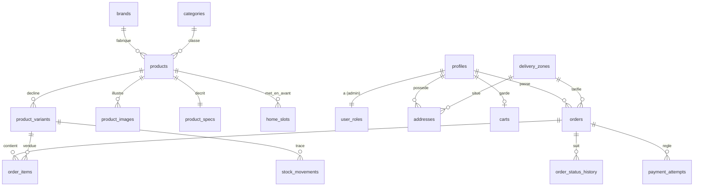

# VERSUS : plan de projet final

> **Statut** : version de référence, à enregistrer dans `docs/PLAN.md` (révision 2, après la revue de démarrage).
> **Date** : 12 novembre 2026.
> **Base** : le plan « pedago » (retenu par le jury), avec toutes les erreurs techniques relevées par le jury corrigées, et les meilleures idées des plans « mvp » et « donnees » ajoutées.
> **Maquette de référence** : `C:\Users\tjuni\Documents\E-commerce\Accueil VERSUS-html\` (`Main.dc.html`, `Device.dc.html`, `img\`).
> - **`Device.dc.html` manque aujourd'hui sur le disque.** Le dossier ne contient que `Main.dc.html`, `README.md`, `support.js`, `vendor\` et `img\`. Or `Main.dc.html` l'importe (`<dc-import name="Device">`) pour tous les visuels, et `ProductVisual` reprend son SVG de secours. Il faut donc le récupérer dans l'outil de design et le remettre dans le dossier **avant l'étape 1** (§6, préalable).
> - La maquette se consulte **en HTTP**, jamais en `file://`, où ses scripts sont bloqués (README de la maquette).
> - `support.js` et `vendor\` ne servent qu'à afficher la maquette. Ils ne sont pas repris dans le projet.
>
> **Dépôt à créer** : `C:\Users\tjuni\Documents\E-commerce\versus\`.

---

## 1. Résumé et principes

### 1.1 Résumé

VERSUS est une boutique **fictive** (projet pédagogique, aucune vente réelle) de produits Apple, Samsung et Xiaomi pour le Togo. Elle affiche des prix en FCFA et propose quatre paiements simulés : T-Money, Flooz, carte et paiement à la livraison.
Le projet utilise Next.js 16.4 (App Router, Cache Components), Supabase (Postgres, RLS, Auth, Storage) et Vercel (projet `versus` du compte personnel, production : https://versus-ecru.vercel.app).
Il avance en **9 étapes**. Chacune est mise en production dès sa fusion, porte un tag git et se présente en 5 minutes.
L'accueil reste fidèle à la maquette validée et corrige toutes les remarques UX. Prix, stock et totaux sont calculés uniquement en base.
La sécurité est démontrée par des tests automatisés (pgTAP, Playwright) et non simplement affirmée.

### 1.2 Principes directeurs

1. **Une étape correspond à une notion enseignable.** Chaque étape suit le même cycle : une branche `etape-N-…`, une PR avec sa preview, la CI verte, la fusion dans `main`, la mise en production automatique, le tag `v0.N.0` et une release GitHub qui donne l'URL de production. La dernière étape porte le tag `v1.0.0`.
2. **La production existe dès le premier jour** (idée reprise de mvp). L'étape 1 met en ligne une vraie page avec le bandeau « fictif » et le `noindex`.
3. **Un lien n'apparaît que si sa page existe.**
   - La navigation, l'en-tête et le pied de page sont pilotés par `src/config/site.ts`, qui ne liste que les routes déjà livrées.
   - Un élément dont la cible n'est pas encore livrée est **masqué**, ou **redirigé** vers une page existante. Le détail figure dans la table « élément → comportement » de l'étape 3.
   - Le test `e2e/liens.spec.ts` s'exécute à chaque étape. Il parcourt les liens internes (`<a href>`) et les `action` de formulaires, et exige une réponse 200. Pour les ancres `#id`, il vérifie que l'`id` existe sur la page cible.
   - Il n'y a pas de page « Bientôt disponible ».
4. **La maquette fait référence.** On reprend ses valeurs (tokens) et sa structure, pas son code. Chaque écart répond à une remarque UX, figure dans `docs/ecarts-maquette.md` et doit être validé (D5).
5. **Le serveur fait foi.** Prix, stock, frais, totaux et transitions de statut sont calculés dans Postgres, par des fonctions transactionnelles. Le client n'envoie que des SKU et des quantités.
6. **La sécurité est en défense en profondeur.**
   - Gardes `requireUser()` et `requireAdmin()` dans une couche d'accès aux données (DAL), appelées **dans chaque page et chaque Server Action**.
   - RLS sur toutes les tables, avec des GRANT explicites. Les droits accordés par défaut par Supabase à `anon` et `authenticated` sont retirés (§5.1).
   - Écritures sensibles uniquement par RPC, qui se protègent elles-mêmes des abus.
   - Jeton invité stocké haché.
   - Clé secrète utilisée à un seul endroit du code applicatif.
7. **Le caractère fictif est visible partout** : bandeau permanent, mentions dans le tunnel de commande, aucun champ de carte, aucun code PIN, `noindex`, pas de JSON-LD `Product` ni `Offer`.
8. **La solution la plus simple qui reste défendable.** Une dépendance n'est ajoutée qu'avec une justification dans un ADR (`docs/decisions/`), et seulement à l'étape où elle sert.

---

## 2. Stack et versions

**Toutes les versions sont figées exactement** (`x.y.z`), et le fichier `package-lock.json` est commité. Partout, on installe avec `npm ci`.
- create-next-app écrit des plages (`^16.4.6`, `^9`, `^4`…). À l'étape 1, juste après sa création, chaque plage est remplacée par la version réellement installée (§6, 1.1).
- `.npmrc` (`save-exact=true`) fige ensuite toutes les installations suivantes.
- `check:forbidden` refuse toute version non exacte dans `package.json`.

| Domaine | Choix | Version | Justification |
|---|---|---|---|
| Runtime | Node | 24.x (`.nvmrc` = `24`, `engines.node` = `24.x`) | Déjà installé. Exigé par supabase-js 2.119 et Vitest 5. Vercel lit `engines`. |
| Framework | Next.js App Router (Turbopack, Cache Components) | `next@16.4.6` (au minimum 16.4.5, correctif de sécurité de novembre) | RSC, `'use cache'`, Server Actions, `proxy.ts`. |
| UI | React / React DOM | 19.3.x (livrés avec Next 16.4) | — |
| Langage | TypeScript `strict` et `noUncheckedIndexedAccess` | **5.9.3** (pas la 7) | `typescript-eslint` (utilisé par `eslint-config-next`) exige une version inférieure à 6.1. |
| Lint | ESLint flat config et `eslint-config-next` (inclut jsx-a11y) | `eslint@9.39.x`, `eslint-config-next@16.4.6` | `next lint` n'existe plus : on lance `eslint .`. |
| Styles | Tailwind CSS v4 et variables CSS | `tailwindcss@4.3.x`, `@tailwindcss/postcss@4.3.x` | Les tokens sont dans `globals.css` (`@theme`), sans `tailwind.config`. |
| Polices | `next/font/google` : Inter et Plus Jakarta Sans | — | Auto-hébergées, sans décalage de mise en page. |
| Données | `@supabase/supabase-js`, `@supabase/ssr` | `2.119.x`, `0.12.7` | Clés `sb_publishable_` et `sb_secret_`, `getClaims()`. |
| CLI base | `supabase` (dépendance de dev) | `3.1.x` | Migrations, seed, `gen types`, `test db` (pgTAP). Les options `--remote` sont à vérifier avec `--help`. |
| Validation | `zod` | 4.x (figé à l'installation) | Mêmes schémas pour les formulaires, les Server Actions et les variables d'environnement. |
| Utilitaires | `clsx`, `server-only` | dernières stables | `server-only` empêche d'importer un module serveur côté client. |
| Scripts TS | `tsx` (dev) | dernière stable | Exécute `scripts/*.ts`, qui importent `src/` avec l'alias `@/`. Le retrait natif des types de Node 24 ne résout pas les alias et refuse `enum` et `namespace`. |
| Tests unitaires | Vitest, Testing Library, jsdom | `vitest@5.1.x`, `@vitejs/plugin-react`, `vite-tsconfig-paths` | Logique pure, composants clients et `scripts/check-forbidden`. |
| Tests e2e et a11y | Playwright et `@axe-core/playwright` | `@playwright/test@1.65.x` (version d'axe figée à l'installation) | Parcours, liens, accessibilité, régression visuelle, budgets de poids. Sert aussi aux captures de la maquette. |
| Tests SQL | pgTAP via `supabase test db` | fourni par la CLI | Prouve RLS, les droits, les RPC et les contraintes. |
| Format | Prettier et `prettier-plugin-tailwindcss` | dernières stables | Trie les classes et rend les diffs propres. |
| Hébergement | Vercel, région des fonctions `cdg1` ; Supabase `eu-west-3` (Paris) | — | Régions proches l'une de l'autre et de l'Afrique de l'Ouest. |

**Écartés volontairement** (ADR 001) :
- shadcn/ui, qui éloignerait l'interface de la maquette ;
- framer-motion, puisque les animations sont en CSS ;
- Zustand : un `useReducer` dans un contexte est plus pédagogique et se teste comme une fonction pure ;
- Prisma et Drizzle, qui masqueraient RLS et les RPC ;
- React Compiler ;
- Supabase Branching (payant) ;
- les transformations d'images Supabase (réservées au plan Pro).

**Sources** :
- Next 16.4 : https://nextjs.org/blog/next-16-4
- Correctif de sécurité : https://nextjs.org/blog/november-2026-security-release
- Migration v16 (`proxy.ts`, API asynchrones, `next/image`, `revalidateTag`, suppression des métriques `size` et `First Load JS` de `next build`) : https://nextjs.org/docs/app/guides/upgrading/version-16
- Cache Components : https://nextjs.org/docs/app/getting-started/caching
- Mutations et `updateTag` : https://nextjs.org/docs/app/getting-started/mutating-data
- Authentification et DAL : https://nextjs.org/docs/app/guides/authentication
- CSP : https://nextjs.org/docs/app/guides/content-security-policy
- create-next-app : https://nextjs.org/docs/app/api-reference/cli/create-next-app
- TypeScript 7 dans Next : https://nextjs.org/docs/app/api-reference/config/typescript#using-typescript-7
- Vitest : https://nextjs.org/docs/app/guides/testing/vitest
- Playwright : https://nextjs.org/docs/app/guides/testing/playwright
- Tailwind v4 avec Next : https://tailwindcss.com/docs/installation/framework-guides/nextjs
- Client SSR Supabase : https://supabase.com/docs/guides/auth/server-side/creating-a-client?queryGroups=framework&framework=nextjs
- Pièges SSR Supabase (`Set-Cookie` et cache) : https://supabase.com/docs/guides/auth/server-side/advanced-guide
- Clés API Supabase : https://supabase.com/docs/guides/getting-started/api-keys
- RLS : https://supabase.com/docs/guides/database/postgres/row-level-security
- Droits par défaut sur les fonctions : documentation Supabase, section « Function privileges »
- RBAC : https://supabase.com/docs/guides/api/custom-claims-and-role-based-access-control-rbac
- Migrations : https://supabase.com/docs/guides/local-development/database-migrations
- Types générés : https://supabase.com/docs/guides/api/rest/generating-types
- CLI : https://supabase.com/docs/guides/local-development/cli/getting-started
- Tests pgTAP : https://supabase.com/docs/guides/database/testing
- pg_cron : https://supabase.com/docs/guides/database/extensions/pg_cron
- Pause des projets Free : https://supabase.com/docs/guides/platform/free-project-pausing
- Tarifs Supabase : https://supabase.com/pricing
- Variables Vercel : https://vercel.com/docs/environment-variables/manage-across-environments
- Variables sensibles : https://vercel.com/docs/environment-variables/sensitive-environment-variables
- `vercel env` : https://vercel.com/docs/cli/env
- Crons Vercel : https://vercel.com/docs/cron-jobs
- Contournement de la Deployment Protection : https://vercel.com/docs/deployment-protection/methods-to-bypass-deployment-protection/protection-bypass-automation
- Animations au scroll (Baseline) : https://web.dev/blog/web-platform-10-2026
- Branches protégées GitHub : https://docs.github.com/en/repositories/configuring-branches-and-merges-in-your-repository/managing-protected-branches/about-protected-branches

---

## 3. Architecture du dépôt

### 3.1 Arborescence commentée

```
versus/
├─ .github/
│  ├─ workflows/ci.yml              # qualite (lint, types, vitest, interdits) ; base (pgTAP, types à jour) dès l'étape 4 ; e2e
│  ├─ workflows/db-deploy.yml       # manuel : supabase db push vers la prod (environnement GitHub « production »)
│  └─ pull_request_template.md      # checklist « Définition de fini »
├─ .editorconfig  .gitattributes (* text=auto eol=lf)  .npmrc (save-exact=true)  .nvmrc (24)
├─ .env.example                     # noms des variables, sans valeur
├─ AGENTS.md                        # créé par create-next-app, complété avec les conventions §3.4
├─ README.md  CHANGELOG.md
├─ next.config.ts                   # images.remotePatterns, en-têtes de sécurité, partialPrefetching: true,
│                                   # experimental.agentFeedback: false (si nécessaire, étape 1) ;
│                                   # n'exige aucune variable d'environnement à l'évaluation (next typegen en CI)
├─ eslint.config.mjs  postcss.config.mjs  tsconfig.json  vercel.json  vitest.config.mts  playwright.config.ts
├─ docs/
│  ├─ PLAN.md                       # ce document
│  ├─ architecture.md               # schéma navigateur → Vercel → Supabase, rendu, clients Supabase, îlots client
│  ├─ base-de-donnees.md            # ERD Mermaid, tables, RLS expliquée en français, droits, RPC
│  ├─ design-system.md              # tokens, composants, correspondance des points de rupture
│  ├─ ecarts-maquette.md            # écart, remarque UX à l'origine, captures avant/après, validé (o/n)
│  ├─ fidelite-maquette.md          # grille section par section
│  ├─ glossaire.md                  # FR (interface) ↔ EN (code) : commande = order, variante = variant…
│  ├─ demo.md                       # scénario de soutenance de 5 à 7 minutes (comptes hors dépôt)
│  ├─ audits/                       # rapports Lighthouse et axe
│  ├─ maquette/captures/            # captures de la maquette à 1440 et 390 px (générées par scripts/capture-maquette.ts)
│  └─ decisions/                    # ADR 001 à 009 (§3.4)
├─ public/products/                 # ip18.png … sb10.png (copiés de la maquette) et SOURCES.md
├─ scripts/
│  ├─ capture-maquette.ts           # Playwright : maquette servie en HTTP, 1440 et 390 px, une capture par section
│  ├─ check-forbidden.mjs           # motifs interdits (§7.3), multiplateforme ; exporte findViolations(path, content)
│  ├─ check-forbidden.test.ts       # la règle testée sur la liste blanche et sur des cas fautifs (dès l'étape 1)
│  ├─ generate-seed.ts              # src/data/catalog.ts → supabase/seeds/20_catalog.sql
│  ├─ seed-demo-users.ts            # client et admin de démo (clé secrète)
│  └─ reset-demo.ts                 # remet stocks, commandes, tentatives et comptes de démo (étape 9)
├─ supabase/
│  ├─ config.toml                   # [api] schemas=["public"], [db.seed] sql_paths, bucket, Auth (site_url, modèles d'e-mail)
│  ├─ migrations/                   # §5.11
│  ├─ templates/                    # confirm.html, recovery.html → /auth/confirm?token_hash=… (étape 7)
│  ├─ seeds/ 20_catalog.sql (généré)  30_home.sql  90_demo_orders.sql (local uniquement)
│  └─ tests/database/               # pgTAP 00_… à 08_… (§7.1)
├─ e2e/                             # liens, accueil, budget, catalogue, produit, panier, comparateur, quiz,
│                                   # commande-invite, paiement, compte, securite, admin, a11y, visuel,
│                                   # concurrence (*.spec.ts)
└─ src/
   ├─ proxy.ts                      # rafraîchit la session Supabase ; matcher restreint (§3.3)
   ├─ config/site.ts                # nav, en-tête, pied de page, réassurance ; seules les routes livrées ; routeFor(clé)
   ├─ app/
   │  ├─ layout.tsx                 # <html lang="fr" data-scroll-behavior="smooth">, <body>, polices, viewport,
   │  │                             # metadata, noindex, SkipLink. AUCUN landmark (<main> est dans chaque gabarit de groupe)
   │  ├─ globals.css                # tokens et @theme (§4)
   │  ├─ not-found.tsx  global-error.tsx  sitemap.ts  robots.ts  icon.svg  opengraph-image.tsx
   │  ├─ (site)/                    # gabarit public : AnnouncementBar, SiteHeader, <main id="contenu">, SiteFooter,
   │  │                             # CompareTray, CartDrawer, Toaster
   │  ├─ (auth)/                    # gabarit épuré : logo, bandeau fictif, <main id="contenu">
   │  ├─ auth/confirm/route.ts      # verifyOtp(token_hash, type) : confirmation d'e-mail, réinitialisation
   │  ├─ auth/callback/route.ts     # exchangeCodeForSession(code) : PKCE (lien magique ou OAuth futurs)
   │  ├─ auth/signout/route.ts      # POST : déconnexion
   │  ├─ api/revalidate/route.ts    # POST protégé par REVALIDATE_SECRET : invalide un tag (démo, scripts)
   │  ├─ api/health/route.ts        # GET protégé par CRON_SECRET : rpc('ping') (cron de maintien en vie)
   │  ├─ admin/                     # gabarit admin séparé (AdminShell, avec son <main id="contenu">)
   │  └─ styleguide/page.tsx        # vitrine du design system ; notFound() en production
   ├─ components/
   │  ├─ ui/        Button, TextLink, Arrow, IconButton, CountBadge, Badge, NewBadge, Pill, PillGroup, Price,
   │  │             Field, Select, RadioCard, Checkbox, Stepper, Dialog, Drawer (<dialog> natif), Toaster,
   │  │             VisuallyHidden, SkipLink, Reveal, SectionHeader, Skeleton, Spinner, EmptyState
   │  ├─ layout/    AnnouncementBar, SiteHeader, MainNav, MobileMenu, Logo, SiteFooter, PaymentBadges, AccountLink
   │  ├─ home/      HeroCarousel, HeroSlide, CarouselControls, ProgressDot, CategoryNav, CategoryChip, PromoTile,
   │  │             BrandCard, CompareShowcase, QuizTeaser, FeatureGrid
   │  ├─ product/   ProductView (fiche, données en props), ProductVisual, ProductCard, ProductRail, ProductGrid,
   │  │             ProductGallery, CatalogFilters, SortSelect, VariantPicker, LiveStock, Breadcrumbs, SpecSheet,
   │  │             DeliveryEstimate, RelatedProducts
   │  ├─ compare/   CompareButton, CompareTray, CompareTable, CompareProductPicker, DiffToggle
   │  ├─ quiz/      QuizStep, QuizProgress, QuizResults, QuizResultItem
   │  ├─ cart/      CartProvider, AddToCartButton, CartDrawer, CartLine, CartSummary, QuantityInput
   │  ├─ checkout/  CheckoutForm, ContactStep, DeliveryStep, PaymentStep, ReviewStep, FictionNotice,
   │  │             PaymentSimulator, UssdScreen, CardDemo, OrderTimeline, OrderSummary
   │  ├─ account/   AccountNav, OrderList, AddressForm, ProfileForm, PasswordForm, DeleteAccountDialog
   │  └─ admin/     AdminShell, AdminNav, DataTable, KpiCard, ProductForm, VariantsEditor, SpecsFields,
   │                ImageUploader, HomeSlotsEditor, StockAdjustForm, OrderStatusActions, ZoneEditor
   ├─ data/catalog.ts               # SOURCE UNIQUE des 9 produits (variantes, specs, images, home_slots) :
   │                                # données de l'étape 3, générateur du seed, fixture des tests
   ├─ lib/
   │  ├─ env.ts  env.server.ts      # variables validées par zod ; siteUrl calculé (§7.5) ; env.server.ts importe 'server-only'
   │  ├─ format/  fcfa.ts  date.ts  phone.ts        # formatFCFA, formatDate (Africa/Lome), normalisation +228
   │  ├─ brand-themes.ts            # thèmes de marque, du hero et couleurs du SVG de secours (couleurs = design, donc code)
   │  ├─ catalog/ types.ts  repository.ts  static-repository.ts  supabase-repository.ts
   │  │           queries.ts ('use cache')  is-new.ts  today.ts  filters.ts  search.ts  image.ts
   │  ├─ cart/    cart-reducer.ts  storage.ts  merge.ts (D9)
   │  ├─ compare/ compare-reducer.ts  rows.ts  highlight.ts  selection.ts   # selection : complète /comparer?p=<1 code>
   │  ├─ quiz/    questions.ts  score.ts
   │  ├─ delivery/fees.ts           # estimation affichée ; le serveur recalcule
   │  ├─ orders/  transitions.ts  labels.ts  errors.ts   # copie de la matrice, libellés FR, codes VS_* → messages
   │  ├─ validation/ checkout.ts  address.ts  profile.ts  auth.ts  product-admin.ts
   │  ├─ auth/    dal.ts  safe-redirect.ts                # getClaims (React cache), requireUser, requireAdmin
   │  ├─ supabase/ public.ts  server.ts  client.ts  admin.ts  proxy.ts
   │  └─ database.types.ts          # GÉNÉRÉ (npm run db:types), jamais modifié à la main
   ├─ server/actions/  cart.ts  checkout.ts  payment.ts  tracking.ts  auth.ts  account.ts
   │                   admin-products.ts  admin-stock.ts  admin-orders.ts  admin-delivery.ts  admin-home.ts
   └─ styles/animations.css         # keyframes et animations au scroll (§4.4)
```

Les tests unitaires sont placés à côté du code testé (`fcfa.test.ts` à côté de `fcfa.ts`). Les tests e2e sont dans `e2e/`.

### 3.2 Toutes les routes

| Route | Fichier | Étape | Rendu et données |
|---|---|---|---|
| `/` | `(site)/page.tsx` | 3 (données locales), 4 (base) | Statique : `getHome()` en `'use cache'` |
| `/boutique` | `(site)/boutique/page.tsx` | 3 (minimale, grille groupée par catégorie avec ancres `#smartphones`…), 4 (filtres) | Coquille statique et grille dans `<Suspense>` (lit `searchParams` : `marque`, `prix`, `stock`, `tri`) |
| `/boutique/[categorie]` | `(site)/boutique/[categorie]/page.tsx` | 4 | `smartphones`, `ecouteurs`, `montres`, `bracelets` ; statique |
| `/marques/[marque]` | `(site)/marques/[marque]/page.tsx` | 4 | `apple`, `samsung`, `xiaomi` ; statique |
| `/produit/[slug]` | `(site)/produit/[slug]/page.tsx`, `loading.tsx`, `opengraph-image.tsx` | 3 (minimale), 4 (complète) | `generateStaticParams` ; contenu en cache ; `<LiveStock>` dynamique sous `<Suspense>` ; `?couleur=&stockage=&taille=` ; produit inactif : 404 |
| `/comparer` | `(site)/comparer/page.tsx` | 5 | `?p=ip18,a57,rn15&diff=1` ; l'URL porte l'état. Avec un seul code, la sélection est complétée (règle de l'étape 5). |
| `/aide-au-choix` | `(site)/aide-au-choix/page.tsx` | 5 | Formulaire GET `?type=&budget=&tel=&prio=`, fonctionne sans JavaScript |
| `/recherche` | `(site)/recherche/page.tsx` | 4 | `?q=` ; recherche TypeScript sur le catalogue en cache |
| `/panier` | `(site)/panier/page.tsx` | 5 | Îlot client et Server Action `priceCart` |
| `/commande` | `(site)/commande/page.tsx` | 6 | Dynamique ; tunnel en 4 étapes |
| `/commande/[numero]/paiement` | `(site)/commande/[numero]/paiement/page.tsx` | 6 | Dynamique ; lit le cookie `vs_ot_<numero>` |
| `/commande/[numero]/confirmation` | `(site)/commande/[numero]/confirmation/page.tsx` | 6 | Dynamique |
| `/suivi` | `(site)/suivi/page.tsx` | 6 | Numéro et téléphone, puis `track_order` |
| `/compte` | `(site)/compte/page.tsx` (+ `layout.tsx` pour la coquille seulement) | 7 | Dynamique ; `requireUser()` dans chaque page |
| `/compte/commandes`, `/compte/commandes/[numero]` | `(site)/compte/commandes/…` | 7 | Annulation, relance du paiement |
| `/compte/adresses`, `/compte/profil`, `/compte/donnees` | `(site)/compte/…` | 7 | Profil (avec changement de mot de passe), export JSON, suppression du compte |
| `/mentions-legales`, `/credits` | `(site)/(infos)/…/page.tsx` | 1 (provisoires), 2 | Statiques |
| `/confidentialite`, `/cgv`, `/livraison`, `/garantie` | `(site)/(infos)/…` | 2 (provisoires), 9 (finales) | Statiques |
| `/faq`, `/contact` (envoi simulé), `/a-propos` | `(site)/(infos)/…` | 9 | Statiques |
| `/connexion`, `/inscription`, `/mot-de-passe-oublie`, `/reinitialiser-mot-de-passe` | `(auth)/…/page.tsx` | 7 | Server Actions dans `server/actions/auth.ts` |
| `/auth/confirm`, `/auth/callback`, `/auth/signout` | `auth/…/route.ts` | 7 | Route Handlers |
| `/admin` | `admin/page.tsx` (+ `layout.tsx` coquille) | 8 | Indicateurs ; `requireAdmin()` dans chaque page |
| `/admin/produits`, `/admin/produits/nouveau`, `/admin/produits/[id]` | `admin/produits/…` | 8 | CRUD sous RLS, avec la session de l'admin |
| `/admin/produits/[id]/apercu` | `admin/produits/[id]/apercu/page.tsx` | 8 | Fiche rendue par `ProductView` avec le client serveur et `requireAdmin()`, **sans cache** ; fonctionne pour un produit inactif |
| `/admin/stock` | `admin/stock/page.tsx` | 8 | `admin_adjust_stock` |
| `/admin/commandes`, `/admin/commandes/[numero]` | `admin/commandes/…` | 8 | `admin_set_order_status` |
| `/admin/livraison`, `/admin/accueil`, `/admin/clients` | `admin/…` | 8 | Zones et réglages ; ordre de l'accueil (`home_slots`) ; clients en lecture seule |
| `/styleguide` | `styleguide/page.tsx` | 2 | `notFound()` en production |
| `/api/revalidate`, `/api/health` | `api/…/route.ts` | 4, 9 | Protégés par un secret |
| `/sitemap.xml`, `/robots.txt` | `sitemap.ts`, `robots.ts` | 1 (robots), 9 (sitemap) | `ALLOW_INDEXING=false` donne `noindex` et `Disallow` |

### 3.3 Accès aux données, session et cache

**Les quatre clients Supabase** (expliqués dans `docs/architecture.md`) :

| Fichier | Création | Usage autorisé |
|---|---|---|
| `lib/supabase/public.ts` | `createClient(url, publishableKey)`, sans cookies | Lectures du catalogue dans `'use cache'`, `LiveStock`, `priceCart`, `trackOrder`. Seul client permis dans `'use cache'`, car `cookies()` y est interdit. |
| `lib/supabase/server.ts` | `createServerClient` branché sur `await cookies()` | Tout ce qui dépend de l'utilisateur (commande, compte, admin, aperçu admin d'une fiche), toujours sous `<Suspense>`, jamais en cache. |
| `lib/supabase/client.ts` | `createBrowserClient` | Upload d'images dans l'admin uniquement. |
| `lib/supabase/admin.ts` | Clé secrète, `import 'server-only'` | **Seulement** `server/actions/account.ts` (suppression de compte) et `scripts/`. Une règle ESLint `no-restricted-imports` et `check-forbidden.mjs` l'imposent. |

**Session et gardes** (corrige la faille relevée par les trois jurés) :
- `src/proxy.ts` appelle `updateSession()` (dans `lib/supabase/proxy.ts`, gabarit officiel) et renvoie **uniquement** `supabaseResponse`. Il ne protège rien : il rafraîchit le jeton.
- Son matcher est **restreint** pour ne jamais poser de `Set-Cookie` sur une page publique mise en cache :
  `['/compte/:path*', '/admin/:path*', '/commande/:path*', '/connexion', '/inscription', '/mot-de-passe-oublie', '/reinitialiser-mot-de-passe', '/auth/:path*']`.
- **Les pages publiques ne lisent jamais la session côté serveur.** L'icône « Mon compte » de l'en-tête (dès l'étape 7) est un simple lien vers `/compte`, qui redirige vers `/connexion` si nécessaire. Il n'y a donc pas de faux état « déconnecté » sur le catalogue. Un îlot client qui afficherait le prénom via `createBrowserClient` (qui rafraîchit le jeton côté navigateur) est en BON.
- `lib/auth/dal.ts` :
  - `getClaims = cache(async () => …auth.getClaims())` ;
  - `requireUser()` : redirige vers `/connexion?redirect=<chemin>` ;
  - `requireAdmin()` : lit la ligne de l'utilisateur dans `user_roles`, autorisée par RLS, et renvoie `notFound()` sinon.
  - **Chaque page** de `/compte/**`, `/commande/**` (si connecté) et `/admin/**`, et **chaque Server Action** sensible les appellent. Les layouts ne font que la coquille, car un layout n'est pas réexécuté à chaque navigation côté client.
  - RLS reste le dernier rempart.
- `lib/auth/safe-redirect.ts` :
  - analyse la cible avec `new URL(redirect, siteUrl)` et exige `url.origin === new URL(siteUrl).origin` ;
  - rejette d'emblée toute valeur qui contient `\`, un caractère de contrôle (`[\u0000-\u001F\u007F]`) ou une forme encodée dangereuse (`%5C`, `%2F%2F`, `%09`, `%0A`, `%0D`, sans tenir compte de la casse), vérifiée avant et après un `decodeURIComponent` ;
  - renvoie `pathname + search + hash` de l'URL analysée, ou `/compte` par défaut.
- Côté serveur, uniquement `getClaims()`, jamais `getSession()` (interdit par `check-forbidden.mjs`).

**Stratégie de cache** :
- `lib/catalog/queries.ts` :
  - `getCatalog()`, `getProduct(slug)` et `getHome()` en `'use cache'` ;
  - `cacheLife('hours')` ;
  - tags `catalog`, `product:<slug>` et `home`.
- **Badge « Nouveau » et date** : `isNew(product, today)` reçoit la date de `lib/catalog/today.ts` (`getToday()`). Cette fonction lit `VS_TODAY` (format `AAAA-MM-JJ`) côté serveur hors production, sinon elle prend la date du jour en Africa/Lome. Le badge est calculé dans le cache : il peut rester périmé jusqu'à l'expiration `cacheLife('hours')` après le passage de `new_until`. C'est assumé et documenté.
- `LiveStock` : `await connection()`, puis lecture du stock des variantes par le client public, **sans cache**, sous `<Suspense>`. C'est la démonstration du rendu partiel (PPR) : le stock d'une fiche est toujours exact.
- Mutations admin (Server Actions) : `updateTag('catalog')`, `updateTag('product:<slug>')`, `updateTag('home')`. L'admin voit le changement immédiatement.
- Aperçu admin (`/admin/produits/[id]/apercu`) : client serveur, `requireAdmin()`, aucun `'use cache'`. La fiche publique passe par le client public en cache et RLS masque les produits inactifs : elle ne peut donc pas servir d'aperçu.
- Après une commande (`placeOrder`) : `revalidateTag('catalog', 'max')`. Les pastilles « En stock » des listes peuvent rester brièvement périmées, c'est assumé et documenté. La fiche utilise `LiveStock` et `create_order` revérifie le stock.
- `/api/revalidate` (POST, en-tête `x-revalidate-secret`) appelle `revalidateTag(tag, { expire: 0 })` pour une expiration immédiate depuis un Route Handler (syntaxe à vérifier dans la documentation v16). Il remplace le critère irréalisable « revalidateTag par script ».
- Les pages `/commande/**`, `/compte/**` et `/admin/**` sont toujours dynamiques : aucun `'use cache'` dans ces segments.

**Pourquoi filtrer et chercher en TypeScript** : avec moins de 50 produits déjà en cache, une fonction pure testée (`filters.ts`, et `search.ts` avec `normalize('NFD')`) est plus simple qu'une requête par filtre. Le passage à `unaccent`, `pg_trgm` et une RPC `search_products` est décrit dans le README comme une évolution possible.

**Dépôt de catalogue** (idée de mvp) :
- `lib/catalog/repository.ts` définit l'interface `CatalogRepository` : `listProducts()`, `getProductBySlug()`, `getHome()`, `listBrands()`, `listCategories()`, `getVariantsStock(productId)`.
- À l'étape 3, `static-repository.ts` lit `src/data/catalog.ts`. À l'étape 4, `supabase-repository.ts` prend le relais **sans toucher aux composants**.
- `catalog.ts` n'est pas supprimé : il génère le seed (`scripts/generate-seed.ts`) et sert de fixture aux tests.

### 3.4 Conventions

- **Langues.**
  - Interface, URL, commentaires, documentation et commits en français.
  - Identifiants de code et de base en anglais (`snake_case` en SQL, `camelCase` en TS).
  - Les libellés français sont centralisés (`lib/orders/labels.ts`) ; `docs/glossaire.md` fait la correspondance.
- **Fichiers.**
  - Composants en `PascalCase.tsx`, un export par fichier, environ 150 lignes au plus.
  - Modules en `kebab-case.ts`.
  - Tout module serveur commence par `import 'server-only'`.
  - Les Server Actions vivent dans `src/server/actions/*.ts` avec `'use server'`.
- **Composants serveur par défaut.** `'use client'` est réservé aux îlots listés dans `docs/architecture.md` : HeroCarousel, ProductRail (flèches), PillGroup, CompareButton et CompareTray, CartProvider et CartDrawer, VariantPicker, MobileMenu, CheckoutForm, PaymentSimulator, et les formulaires admin.
- **Landmarks.** Le layout racine n'en contient aucun (html, body, polices, SkipLink). Chaque gabarit de groupe (`(site)`, `(auth)`, `admin`) place `<main id="contenu">` entre son en-tête et son pied de page. Les pages hors groupe (`not-found.tsx`, `global-error.tsx`, `styleguide`) déclarent leur propre `<main id="contenu">`.
- **Gabarit de Server Action** (identique partout) :
  1. `parse` zod ;
  2. `requireUser()` ou `requireAdmin()` si nécessaire ;
  3. RPC ou requête soumise à RLS ;
  4. `updateTag` ou `revalidateTag(tag, 'max')` ;
  5. retour `{ ok: true, data } | { ok: false, code, fieldErrors }`.
  Côté client : `useActionState`.
- **Erreurs.**
  - Les RPC lèvent `raise exception using errcode = 'P0001', message = 'VS_<CODE>', detail = <json>`.
  - `lib/orders/errors.ts` traduit les codes `VS_INVALID`, `VS_ACK_REQUIRED`, `VS_UNAVAILABLE`, `VS_OUT_OF_STOCK`, `VS_COD_CAP`, `VS_EXPIRED`, `VS_NOT_FOUND`, `VS_FORBIDDEN`, `VS_INVALID_TRANSITION`, `VS_RATE_LIMITED` (suivi et création de commande).
  - Chaque segment a un `error.tsx` avec un bouton « Réessayer » ; aucune exception brute n'est affichée.
- **Montants** : `integer` en FCFA, suffixe `_fcfa`. Le seul formateur est `formatFCFA()`.
- **Dates** : `timestamptz` en base ; affichage `Intl.DateTimeFormat('fr-FR', { timeZone: 'Africa/Lome' })`. Toute logique qui dépend de « aujourd'hui » passe par `getToday()` (injectable par `VS_TODAY` dans les tests).
- **Git.**
  - Branche `main` toujours déployable.
  - Une branche par étape (`etape-3-accueil`).
  - Commits conventionnels en français (`feat(panier): ajouter le tiroir mini-panier`).
  - Tag `v0.N.0` et release GitHub à chaque fin d'étape ; `CHANGELOG.md` tenu à jour.
- **ADR** : `001-stack`, `002-tokens-tailwind`, `003-etat-client`, `004-specs-colonnes-typees`, `005-paiement-simule`, `006-noindex`, `007-roles-admin`, `008-jeton-invite`, `009-environnements`.
- **Définition de « fini »** (modèle de PR, pour toutes les étapes) :
  - lint, types (`next typegen && tsc --noEmit`), Vitest, `check-forbidden` et e2e verts ;
  - preview vérifiée à 375 px et à 1440 px ;
  - `liens.spec` vert (liens, `action` de formulaires, ancres) ;
  - axe sans violation « serious » ni « critical » sur les pages touchées ;
  - budgets respectés, mesurés par `e2e/budget.spec.ts` dès l'étape 3 : JS < 150 Ko compressé sur `/` et une fiche, poids transféré de `/` < 1 Mo ;
  - documentation à jour ;
  - captures dans `docs/fidelite-maquette.md` si l'interface a changé ;
  - critères de l'étape cochés.

---

## 4. Design system

### 4.1 Tokens en 3 couches (`src/app/globals.css`)

1. **Primitives** : la palette brute relevée dans la maquette.
2. **Sémantique** : les rôles. Les composants n'utilisent que cette couche.
3. **Pont Tailwind** : `@theme inline` (références `var()` uniquement). Les points de rupture vont dans un `@theme` **non** inline.

```css
@import "tailwindcss";
@import "../styles/animations.css";

:root {
  /* 1. Primitives (maquette) */
  --gray-950:#1D1D1F; --gray-700:#424245; --gray-600:#6E6E73; --gray-500:#86868B; --gray-400:#A1A1A6;
  --gray-300:#D2D2D7; --gray-200:#EDEDF0; --gray-100:#EAEAEE; --gray-50:#F5F5F7; --gray-25:#FBFBFD;
  --night-900:#0B0B0C; --night-800:#1C1C1E; --night-700:#2C2C2E; --night-950:#111113;
  --green-700:#006B4B; --green-600:#00805A; --green-300:#3DDC97; --green-50:#E6F4EE;   /* accent VERSUS (§4.2) */

  /* 2. Sémantique */
  --bg:#fff; --ink:var(--gray-950); --surface:var(--gray-50); --surface-2:var(--gray-25);
  --surface-hover:var(--gray-100); --line:var(--gray-300); --line-soft:var(--gray-200);
  --muted:var(--gray-600); --muted-strong:var(--gray-700);
  --muted-on-dark:var(--gray-400); --eyebrow-on-dark:var(--gray-500);
  --accent:var(--green-600); --accent-hover:var(--green-700);
  --accent-on-dark:var(--green-300); --accent-soft:var(--green-50);
  --danger:#C62828; --warning:#8A5A00; --focus-ring:var(--accent);

  /* Échelle typographique, mobile d'abord */
  --text-hero:48px; --text-tile:40px; --text-h2:36px; --text-quiz:24px; --text-sub:17px;
}
@media (min-width:641px)  { :root { --text-tile:58px; --text-h2:52px; --text-quiz:30px; --text-sub:21px; --text-hero:64px; } }
@media (min-width:1025px) { :root { --text-hero:88px; } }

@theme {                               /* valeurs littérales : PAS dans @theme inline */
  --breakpoint-*: initial;
  --breakpoint-sm:641px; --breakpoint-md:901px; --breakpoint-lg:1025px; --breakpoint-xl:1240px;
}
@theme inline {
  --color-bg:var(--bg); --color-ink:var(--ink); --color-surface:var(--surface); --color-surface-2:var(--surface-2);
  --color-line:var(--line); --color-line-soft:var(--line-soft); --color-muted:var(--muted);
  --color-accent:var(--accent); --color-accent-hover:var(--accent-hover);
  --color-accent-on-dark:var(--accent-on-dark); --color-accent-soft:var(--accent-soft);
  --font-sans:var(--font-inter); --font-display:var(--font-jakarta);
  --radius-tile:30px; --radius-box:28px; --radius-card:26px; --radius-result:18px;
  --radius-option:16px; --radius-icon:14px; --radius-chip:8px;
  --shadow-card:0 30px 60px -30px rgb(0 0 0 / .35); --shadow-tray:0 20px 40px -12px rgb(0 0 0 / .45);
  --ease-out:cubic-bezier(.2,.7,.2,1); --ease-bounce:cubic-bezier(.3,1.6,.5,1);
}
@utility wrap    { max-width:1240px; margin-inline:auto; padding-inline:24px; }
@utility section { padding-block:76px; @media (min-width:641px) { padding-block:110px; } }
@utility eyebrow { font-size:13px; font-weight:600; letter-spacing:.1em; text-transform:uppercase; color:var(--muted); }
:focus-visible { outline:2px solid var(--focus-ring); outline-offset:2px; }
[data-tone="dark"] { --focus-ring:var(--accent-on-dark); }
```

- **Points de rupture.** La maquette est pensée desktop d'abord (`max-width` 1024, 900, 640). On la traduit en mobile d'abord avec des seuils équivalents : base ≤ 640, `sm` ≥ 641, `md` ≥ 901, `lg` ≥ 1025. La table de correspondance est dans `docs/design-system.md`.
- **Thèmes de marque** : `[data-brand="apple|samsung|xiaomi"]` définit `--brand-ground`, `--brand-ink` et `--brand-acc` (Apple : `#F5F5F7` / `#1D1D1F` / `#1D1D1F` ; Samsung : `#EEF1FB` / `#1428A0` / `#1428A0` ; Xiaomi : `#FFF1E6` / `#A84300` / `#FF6900`).
- **Dégradés du hero et couleurs du SVG de secours** : ils sont dans `lib/brand-themes.ts`. Les dégradés sont injectés en variables inline (`style={{'--hero-from': …}}`). `ProductVisual` importe ses couleurs de secours depuis ce fichier. Aucune couleur n'est écrite en dur dans le JSX des composants.
- **Polices** :
  - `Inter({ subsets:['latin'], variable:'--font-inter', display:'swap' })` ;
  - `Plus_Jakarta_Sans({ subsets:['latin'], weight:['600','700','800'], variable:'--font-jakarta', display:'swap' })` ;
  - `h1` à `h4` en `font-display`, avec `letter-spacing:-.025em` ;
  - utilitaires `text-display-hero` (`var(--text-hero)` / .95 / -.05em), `text-display-tile` et `text-display-h2` (/ 1.05 / -.035em).

### 4.2 Couleur d'accent VERSUS

La maquette reprend la palette d'apple.com (`#0071E3`, `#0066CC`, `#2997FF`, `#BF4800`). Proposition : un **vert VERSUS**. Il est libre chez les trois marques, évoque le Togo et ne ressemble à aucune marque vendue.

| Token | Valeur | Usage | Contraste (calcul approximatif, **à mesurer dans `/styleguide`**) |
|---|---|---|---|
| `--accent` | `#00805A` | CTA principaux, liens, pastilles des compteurs, `aria-current`, focus | environ 5:1 avec du texte blanc et sur fond blanc (AA) |
| `--accent-hover` | `#006B4B` | survol et état actif | environ 6,5:1 |
| `--accent-on-dark` | `#3DDC97` | liens et CTA sur fonds sombres (quiz, tuiles noires) | environ 12:1 sur `#000` |
| `--accent-soft` | `#E6F4EE` | badge « Nouveau », sélection active, « meilleure valeur » du comparateur | — |

- **Alternative** si le vert est refusé : indigo `#5B3DF5` (avec `#A99BFF` sur fond sombre).
- **Correspondances** avec la maquette :
  - `--primary` et `--link` deviennent `--accent` ;
  - `--primary-on-dark` devient `--accent-on-dark` ;
  - `--badge-new` devient la capsule `accent-soft` / `accent-hover` ;
  - la barre du quiz devient un dégradé de `--accent-on-dark` vers `#9BE8C4`.
- **Le bleu Apple disparaît** : l'accent Apple devient `#1D1D1F`. Les littéraux `#0071E3`, `#0066CC` et `#2997FF` sont interdits dans tout `src/`, liste blanche comprise (`check-forbidden.mjs`).
- **Signatures VERSUS** :
  - monogramme « VS » avec une barre oblique en accent ;
  - badge « Nouveau » en capsule ;
  - séparateur « × » entre les produits comparés ;
  - anneau de focus de 2 px ;
  - liens fléchés « → » au lieu de « › » ;
  - eyebrows précédés d'un carré accent de 6 px.

### 4.3 Catalogue de composants

| Composant | Origine (maquette) | S/C | Props principales | Corrections intégrées |
|---|---|---|---|---|
| `Button` | `btn-l`, `btn-d`, `btn-buy`, `pill-btn`, `cmp-btn` | S | `variant: 'primary'\|'dark'\|'light'\|'outline'\|'onDark'\|'brand'`, `size: 'md'(44)\|'lg'(48)`, `href?`, `pressed?` | Focus visible, `aria-pressed`, cibles d'au moins 44 px, `scale(1.04)` uniquement sans mouvement réduit |
| `TextLink` + `Arrow` | `lnk-*`, `.arr` | S | `tone`, `href` | La flèche se décale aussi au `:focus-visible` |
| `IconButton` + `CountBadge` | `.ibtn`, `.count` | C | `label`, `icon`, `count` | Libellé « Panier, 3 articles » ; `aria-live="polite"` ; animation `bump` rejouée par `key` |
| `SiteHeader`, `MainNav`, `MobileMenu` | `.hdr` | S + îlot C | `groups` (de `config/site.ts`) | Menu mobile (`<dialog>`) ≤ 900 px ; `aria-current` ; en-tête opaque sur mobile (écart D5) ; chaque icône (Rechercher, Comparateur, Panier, Mon compte) est masquée tant que sa route n'est pas livrée |
| `HeroCarousel` et sous-composants | hero | C | `slides`, `interval=6000` | §4.5 |
| `CategoryNav`, `CategoryChip` | `nav.cats` | S | `items` (de `config/site.ts`) | Cibles selon l'étape (table de l'étape 3) : `/boutique#<categorie>` puis `/boutique/[categorie]` ; `#comparer` puis `/comparer` ; `#aide` seulement quand `QuizTeaser` est affiché |
| `PromoTile` | `.tile` | S | `product`, `size`, `themeKey`, `secondary` | « Acheter » ouvre la fiche ; « Comparer » ouvre `/comparer?p=<code>` dès l'étape 5 (masqué avant) |
| `ProductVisual` | Device.dc.html | S | `image?`, `kind`, `alt`, `sizes`, `priority?` | `next/image` avec `width`/`height` de la base ; SVG de secours avec `useId()` et couleurs lues dans `brand-themes.ts` ; attribut `data-product="<code>"` (test de répétition) |
| `ProductView` | — | S | `product`, `variants`, `stockSlot` | Fiche complète en props : sert à `/produit/[slug]` (client public, cache) et à l'aperçu admin (client serveur, sans cache) |
| `ProductCard` | `.card` | S + îlots C | `product`, `index` | « À partir de » ; badge « Nouveau » conditionnel ; « Acheter » ouvre la fiche (choix de la variante) ; « + Comparer » dès l'étape 5 ; `aria-pressed` |
| `ProductRail` | `.rail` | C | `products`, `label` | Flèches désactivées aux extrémités, `scrollBy` d'une carte, `role="region"`, `ul/li`, clavier |
| `PillGroup` | `.pills` | C | `options`, `value`, `onChange` ou `hrefFor` | `aria-pressed`, ou `aria-current` quand ce sont des liens |
| `BrandCard` | `.brand` | S | `brand`, `visual` | Lien vers `/boutique` (étape 3) puis `/marques/[marque]` (étape 4) ; nom accessible court |
| `CompareShowcase` | pin et `#comparer` | S + onglets C | `groups` | Remplace la section pin ; vrai `<table>` de 6 lignes clés (écart D5) ; bouton panier selon D5, actif à l'étape 5 (§4.5) |
| `CompareTable` | `.cmp-box` | S | `products`, `rows`, `onlyDiff?` | `<caption>`, `th scope`, meilleure valeur indiquée par un texte |
| `CompareTray` | `.tray` | C | — | `role="status"`, lien vers `/comparer?p=…`, « Vider » |
| `QuizTeaser` | quiz | S (formulaire GET) | — | Question 1 seule (écart D5), `action="/aide-au-choix"` ; affiché à partir de l'étape 5 |
| `QuizStep`, `QuizProgress`, `QuizResults` | quiz | S (formulaire GET) | `step`, `answers` | `fieldset`/`legend`, `role="progressbar"`, focus sur la `legend`, état vide |
| `FeatureGrid`, `SiteFooter`, `PaymentBadges` | réassurance, `.foot` | S | — | Liens issus de `config/site.ts` |
| `Dialog`, `Drawer`, `Toaster`, `Stepper`, `Field`, `RadioCard` | nouveaux | C | — | `<dialog>` natif ; erreurs reliées par `aria-describedby` ; `autocomplete` et `inputmode="tel"` |

### 4.4 Mouvement (`src/styles/animations.css`)

- Keyframes reprises de la maquette : `up`, `art-in`, `float`, `glow`, `spin`, `fill`, `bump`, `tray-in`, `q-in`.
- **Règle anti-régression** : l'état par défaut est **toujours visible**. Toute animation d'entrée est déclarée dans `@media (prefers-reduced-motion: no-preference)`. Cela corrige le bug de la maquette, où le texte du hero restait invisible sous mouvement réduit.
- Les animations au scroll (`reveal`, `zoom`, `rise`) sont placées sous `@supports (animation-timeline: view())` **et** sous cette media query.
- Les doublons `bumpA`/`bumpB`, `qa`/`qb` et `cf*` sont supprimés : on rejoue une animation avec une `key` React.

### 4.5 Corrections UX intégrées

| Remarque | Solution retenue | Étape |
|---|---|---|
| Visuels qui débordaient ; pas de viewport | Déjà corrigés dans la maquette. On garde `ProductVisual` dans un conteneur à hauteur fixée avec `object-contain`, et `export const viewport` dans `layout.tsx`. | 1 et 3 |
| Page trop longue, iPhone affiché 6 fois, tuiles et pin en doublon | **Section pin supprimée** et fusionnée dans `CompareShowcase` (titre du pin « iPhone, Galaxy ou Redmi ? », 3 téléphones en en-tête du tableau, sans hauteur ajoutée). **Tuile iPhone supprimée.** Les cartes marque utilisent d'autres visuels (Apple : aw12, Samsung : gb4, Xiaomi : rw6). **Critères mesurables** (étapes 3 et 9) : hauteur de `/` à 1440 px ≤ 6 000 px (maquette : environ 8 600 px) ; aucun produit visible plus de 3 fois à l'état initial (test générique, tous produits confondus). | 3 |
| Section pin de 2200 px fragile | Supprimée ; aucun `sticky` sur une grande hauteur. | 3 |
| Badge « Nouveau » partout | `isNew(product, today)` : `new_until >= today` (fuseau Africa/Lome), testé ; `today` vient de `getToday()`, injectable par `VS_TODAY`. Retiré des puces du hero. | 3 |
| Rail sans flèches | `ProductRail` avec flèches, désactivation aux extrémités, clavier et scroll-snap. | 3 |
| Comparateur trop pauvre | 12 lignes typées (§5.4) sur `/comparer` : prix, écran, fréquence, puce, autonomie, stockage, poids, photo, charge, IP, 5G ou réduction de bruit, compatibilité, garantie. Sur l'accueil, `CompareShowcase` montre 6 lignes clés, prix compris (marquées `home: true` dans `rows.ts`), contre 3 lignes, le prix et « Ajouter au panier » dans la maquette (écart D5). | 3 (accueil), 5 (page) |
| Quiz avec une question inutile | Q3 (téléphone) posée **seulement** pour l'audio et les montres ; Q4 (priorité) facultative et utilisée dans le score ; tranches de budget par famille ; état vide explicite. Sur l'accueil, le quiz interactif de la maquette devient un `QuizTeaser` (question 1 seule, formulaire GET vers `/aide-au-choix`) : écart D5. | 5 |
| Boutons qui ne mènent nulle part | Chaque CTA visible a une route réelle. Un élément dont la route n'est pas livrée est masqué ou redirigé (table de l'étape 3). Navigation, en-tête et pied de page pilotés par `config/site.ts`. `liens.spec.ts` contrôle les liens, les `action` de formulaires et les ancres à chaque étape. | 1 à 9 |
| Identité trop proche d'apple.com | §4.2. | 2 |
| Carrousel | Changement de diapositive déclenché par `animationend` de la barre de progression (une seule horloge, pause synchronisée). Pause au survol, au focus et quand l'onglet est caché. Flèches du clavier. Pas d'autoplay sous mouvement réduit. **Un seul `h1`** (titre de page en `VisuallyHidden`) ; les diapositives portent des `h2`. | 3 |
| Pas de navigation mobile, de lien d'évitement ni de `<main>` | `MobileMenu`, `SkipLink` (layout racine), `<main id="contenu">` dans **chaque gabarit de groupe**, entre l'en-tête et le pied de page : `banner` et `contentinfo` restent au premier niveau. | 1 et 2 |
| Purge silencieuse du comparateur | Autre famille : `Dialog` « Le comparateur accepte 3 produits d'une même famille. Remplacer la sélection ? ». 4e produit : toast qui nomme le produit retiré. Retirer un produit ne change pas l'onglet. « Comparer » depuis un produit seul ouvre un tableau de **sa** famille (règle de l'étape 5), et non l'onglet Smartphones comme dans la maquette. | 5 |
| Prix avec des espaces sécables | `formatFCFA()` : `Intl.NumberFormat('fr-FR')` puis une espace insécable et « FCFA ». | 1 |
| Performance et réactivité (besoins non fonctionnels) | Poids transféré de `/` < 1 Mo ; JS < 150 Ko compressé ; TBT Lighthouse < 200 ms comme approximation de l'INP < 200 ms. | 3 et 9 |

**Ordre final de l'accueil** :
1. `AnnouncementBar` ;
2. `SiteHeader` ;
3. `HeroCarousel` (ip18, gw9, rn15) ;
4. `CategoryNav` ;
5. `PromoTile` × 5 (A57 en pleine largeur, puis AirPods 5, Galaxy Buds 4, Apple Watch Series 12, Redmi Watch 6) ;
6. Nouveautés (`PillGroup` et `ProductRail`) ;
7. `BrandCard` × 3 ;
8. `CompareShowcase` (`#comparer`) : onglets de famille, tableau de 6 lignes clés (prix compris), bouton « Ajouter au panier » selon D5 (actif à l'étape 5), lien « Comparateur complet → » (étape 5) ;
9. `QuizTeaser` (`#aide`) : la question 1, en formulaire GET vers `/aide-au-choix`, sans JavaScript (affiché à partir de l'étape 5) ;
10. `FeatureGrid` ;
11. `SiteFooter`.

`CompareTray` et `CartDrawer` sont des éléments globaux du layout `(site)` (étape 5).

### 4.6 Garantir la fidélité à la maquette

- Captures de la maquette à 1440 et 390 px dans `docs/maquette/captures/`, produites à l'étape 1 par `scripts/capture-maquette.ts` sur la maquette **servie en HTTP**, avec `Device.dc.html` restauré.
- La page `/styleguide` montre les couleurs avec leurs contrastes mesurés, la typographie, tous les états des boutons, les cartes et les tuiles.
- `docs/fidelite-maquette.md` contient une ligne par section : capture de la maquette, capture de l'implémentation, « conforme » ou renvoi vers l'écart.
- `docs/ecarts-maquette.md` montre, pour chaque écart de D5, une capture avant (maquette) et après (maquette retouchée ou implémentation), et indique s'il est validé.
- Régression visuelle : `e2e/visuel.spec.ts` (`toHaveScreenshot`, 1440 et 390 px, animations coupées, `VS_TODAY` fixé). La référence est prise à la fin de l'étape 3, après validation.

---

## 5. Modèle de données Supabase

### 5.0 Noms canoniques (utilisés partout)

| Domaine | Tables |
|---|---|
| Identité | `profiles`, `user_roles`, `addresses`, `carts` (selon D9) |
| Catalogue | `brands`, `categories`, `products`, `product_variants`, `product_images`, `product_specs`, `home_slots` |
| Vue | `catalog_products` |
| Livraison et réglages | `delivery_zones`, `shop_settings` |
| Commandes | `orders`, `order_items`, `order_transitions`, `order_status_history`, `payment_attempts`, `stock_movements` |
| Schéma `private` (non exposé) | `private.track_attempts`, `private.order_attempts` et les fonctions utilitaires |
| Séquence | `public.order_number_seq` (créée par la migration `orders`, étape 6) |
| Bucket | `product-images` |



### 5.1 Socle (migration `extensions_and_private`)

- Le schéma `private` n'est pas exposé par l'API (`config.toml` : `[api] schemas = ["public"]`).
  - `grant usage on schema private to anon, authenticated;` est nécessaire pour que les politiques RLS appellent `private.is_admin()`.
- **Droits par défaut de Supabase** (documentation Supabase « Function privileges ») :
  - Sur Supabase, les rôles postgres accordent par défaut `EXECUTE` **directement** à `anon`, `authenticated` et `service_role` sur les fonctions de `public`. Ils accordent aussi des droits sur les tables et les séquences. Un `revoke … from public` ne retire donc pas ces droits.
  - Le droit de `PUBLIC` sur les fonctions vient d'un défaut **global**, et non d'un défaut par schéma. `alter default privileges in schema public revoke execute on functions from public` est donc sans effet.
  - En première instruction de la migration :

```sql
-- 1. Défaut GLOBAL (sans « in schema ») : les fonctions créées ensuite par postgres ne sont plus exécutables par PUBLIC.
alter default privileges revoke execute on functions from public;

-- 2. Défauts propres à Supabase dans public : plus aucun droit implicite pour anon et authenticated.
--    (une instruction par type d'objet, comme l'exige la syntaxe ; service_role garde ses droits pour les scripts)
alter default privileges for role postgres in schema public revoke all on tables    from anon, authenticated;
alter default privileges for role postgres in schema public revoke all on sequences from anon, authenticated;
alter default privileges for role postgres in schema public revoke all on functions from anon, authenticated;
```

  - Conséquence : **chaque** table, vue, séquence et fonction reçoit des GRANT explicites. Ces défauts ne valent que pour les objets créés **après** cette migration, ce qui couvre tous les nôtres.
- `pgcrypto` (schéma `extensions`, actif par défaut sur Supabase) fournit `extensions.gen_random_bytes` et `extensions.digest`.
- Fonction utilitaire : `private.set_updated_at()` (trigger).
  - `private.next_order_number()` n'est **pas** créée ici. Elle lit `public.order_number_seq`, et le corps d'une fonction SQL est validé à la création (`check_function_bodies`) : `supabase db reset` échouerait. La séquence et la fonction sont créées par la migration `orders` de l'étape 6 (§5.6).
- **Règle appliquée à chaque migration** :
  - `alter table … enable row level security` dans la migration qui crée la table ;
  - `revoke all on … from anon, authenticated` puis des GRANT explicites (tables, vues et séquences) ;
  - toute fonction en `security definer set search_path = ''`, avec des noms qualifiés ;
  - pour chaque fonction, `revoke all on function … from public, anon, authenticated;` puis un `grant execute` ciblé (ou aucun pour une fonction interne) ;
  - toute nouvelle fonction exposée est ajoutée à la liste blanche de `00_security_baseline` ;
  - une seule politique permissive par action et par rôle (on combine avec `or`) ;
  - toujours `(select auth.uid())` et `(select private.is_admin())`.

### 5.2 Types énumérés (migration `enums`)

```sql
create type public.user_role       as enum ('admin');
create type public.compare_group   as enum ('phones','audio','wearables');
create type public.visual_kind     as enum ('phone','watch','round','band','buds');
create type public.home_slot_kind  as enum ('hero','tile','rail','compare');
create type public.order_status    as enum ('pending_payment','confirmed','preparing','shipped','delivered','cancelled');
create type public.order_actor     as enum ('customer','admin','system');
create type public.payment_method  as enum ('tmoney','flooz','card','cash_on_delivery');
create type public.payment_status  as enum ('pending','succeeded','failed','expired','cash_due','cash_collected');
create type public.attempt_outcome as enum ('pending','succeeded','failed','expired');
create type public.stock_reason    as enum ('order','order_cancelled','restock','correction','damage');
```

### 5.3 Identité et rôle admin (migration `identity`, ADR 007)

| Table | Colonnes et contraintes |
|---|---|
| `profiles` | `id uuid pk → auth.users on delete cascade` · `full_name text not null default '' check (char_length(full_name) <= 120)` · `email text` (copie informative) · `phone text check (phone ~ '^\+228[0-9]{8}$')` · `created_at`, `updated_at` |
| `user_roles` | `user_id uuid pk → profiles on delete cascade` · `role user_role not null` (**sans valeur par défaut**) · `granted_at timestamptz not null default now()` |
| `addresses` (étape 7) | `id uuid pk` · `user_id → profiles cascade` · `label text not null default 'Domicile'` · `recipient_name text not null` · `phone text not null check (+228)` · `zone_code text not null → delivery_zones` · `city text not null`, `district text not null`, `landmark text not null`, `instructions text` · `is_default boolean not null default false` · index unique partiel `(user_id) where is_default` · index `(user_id)` |
| `carts` (étape 7, selon D9) | `user_id uuid pk → profiles on delete cascade` · `items jsonb not null default '[]' check (jsonb_typeof(items) = 'array' and jsonb_array_length(items) <= 10)` (SKU et quantités seulement, **jamais de prix**) · `updated_at` |

- **Le rôle n'est pas dans `profiles`**, que l'utilisateur peut modifier : il est dans `user_roles`, qui n'a **aucune politique d'écriture**. Cela corrige l'incohérence de « pedago » : un admin ne peut pas modifier un rôle depuis l'application.
- La promotion se fait **uniquement** par SQL (`insert into public.user_roles values ('<uuid>','admin')`) dans le SQL Editor, ou par `scripts/seed-demo-users.ts` avec la clé secrète. `/admin/clients` reste en lecture seule.
- Fonction de contrôle :

```sql
create function private.is_admin() returns boolean
language sql stable security definer set search_path = '' as $$
  select exists (select 1 from public.user_roles r where r.user_id = (select auth.uid()) and r.role = 'admin');
$$;
revoke all on function private.is_admin() from public, anon, authenticated;
grant execute on function private.is_admin() to anon, authenticated;
```

- **Trigger `private.handle_new_user()`** (`after insert on auth.users`, definer, aucun `grant execute`). Il reste **minimal** pour qu'il n'échoue jamais : il insère `profiles(id, email, full_name)` avec `left(coalesce(new.raw_user_meta_data->>'full_name',''), 120)`. Il **ne copie pas le téléphone**, et ne lit **jamais** un rôle depuis les métadonnées. Le téléphone facultatif saisi à l'inscription est enregistré par la Server Action d'inscription (étape 7).
- **Droits** :
  - `grant select on profiles to authenticated` ;
  - `grant update (full_name, phone) on profiles to authenticated` ;
  - `grant select on user_roles to authenticated` ;
  - aucun insert, update ou delete sur `user_roles`.

### 5.4 Catalogue (migrations `catalog`, `catalog_rls`, `catalog_view`, `reference_catalog`)

| Table | Colonnes et contraintes |
|---|---|
| `brands` | `slug text pk check (slug ~ '^[a-z0-9-]{2,30}$')` · `name text not null unique` · `tagline text not null` · `position smallint not null default 0` |
| `categories` | `slug text pk` (`smartphones`, `ecouteurs`, `montres`, `bracelets`) · `name text not null` · `intro text not null default ''` · `compare_group compare_group not null` (montres **et** bracelets → `wearables`) · `position smallint` |
| `products` | `id uuid pk default gen_random_uuid()` · `code text unique not null check (code ~ '^[a-z0-9]{2,12}$')` (`ip18` : URL du comparateur, préfixe des SKU) · `slug text unique not null check (slug ~ '^[a-z0-9]+(-[a-z0-9]+)*$')` · `brand_slug → brands on update cascade` · `category_slug → categories on update cascade` · `name text not null` · `tagline text not null` · `description text not null default ''` · `visual_kind visual_kind not null` · `release_date date not null` · `new_until date` (trigger : `release_date + 90` si null) · `warranty_months smallint not null default 12 check (between 0 and 36)` · `compat text[] not null default '{}' check (compat <@ array['ios','android'])` · `box_contents text[] not null default '{}'` · `is_active boolean not null default false` · `created_at`, `updated_at` |
| `product_variants` | `id uuid pk` · `product_id → products cascade` · `sku text unique not null check (sku ~ '^[A-Z0-9-]{4,40}$')` (`IP18-BOR-256`) · `color_name text not null` · `color_slug text not null` · `color_hex text check (~ '^#[0-9A-F]{6}$')` · `storage_gb smallint check (> 0)` · `size_mm smallint check (between 20 and 60)` · `price_fcfa integer not null check (between 1000 and 5000000)` · `stock integer not null default 0 check (stock >= 0)` · `low_stock_threshold smallint not null default 3` · `is_default boolean not null default false` · `is_active boolean not null default true` · `position smallint` · `unique nulls not distinct (product_id, color_slug, storage_gb, size_mm)` |
| `product_images` | `id uuid pk` · `product_id → products cascade` · `color_slug text` (null = toutes couleurs) · `src text not null` (`/products/ip18.png` ou URL publique Storage) · `storage_path text unique` (si upload) · `width int not null check (> 0)` · `height int not null check (> 0)` · `alt text not null` · `is_primary boolean not null default false` · `position smallint` · `credit text`, `source_url text` (alimentent `/credits`) |
| `product_specs` (1-1, ADR 004) | `product_id uuid pk → products cascade` · `screen_size_in numeric(3,2)` · `screen_tech text` · `refresh_hz smallint` · `chip text` · `battery_mah integer` · `autonomy_hours integer` (affiché en jours au-delà de 72 h) · `charging_w smallint` · `main_camera_mp smallint` · `weight_g numeric(5,1)` · `ip_rating text` · `has_5g boolean` · `has_anc boolean` · `specs_note text not null default 'Valeurs indicatives, projet pédagogique'` |
| `home_slots` | `id uuid pk` · `slot home_slot_kind not null` · `position smallint not null` · `product_id → products cascade` · `theme_key text not null default 'default'` (référence `lib/brand-themes.ts`) · `headline text`, `subline text` · `is_active boolean not null default true` · `unique (slot, position)` |

**Choix des colonnes typées (ADR 004)** :
- C'est plus simple à requêter, à valider (`check`) et à expliquer qu'une table entité-attribut-valeur.
- Les lignes du comparateur et les champs de l'admin sont déclarés une seule fois dans `lib/compare/rows.ts`, par `compare_group` : `{ key, label, format, better: 'higher'|'lower'|null, home: boolean }`. `home: true` marque les 6 lignes clés de l'accueil.
- Stockage, Prix et Garantie sont **calculés** à partir des variantes et de `warranty_months`.

**Triggers d'intégrité** (`private.*`, aucun `grant execute`) :
- `products_defaults` : renseigne `new_until`.
- `variants_check_attributes` :
  - un smartphone exige `storage_gb` ;
  - écouteurs et bracelets : `storage_gb` vaut null.
- `products_activation_check` : on ne peut passer `is_active = true` sans une variante active par défaut **et** une image principale. Une fiche cassée ne peut donc pas être publiée.

**Index** :
- chaque clé étrangère : `products(brand_slug)`, `products(category_slug)`, `product_variants(product_id)`, `product_images(product_id, position)`, `home_slots(product_id)` ;
- uniques partiels : `product_variants(product_id) where is_default` et `product_images(product_id) where is_primary` ;
- `products(release_date desc) where is_active`.

**Vue** :

```sql
create view public.catalog_products with (security_invoker = true) as
select p.id, p.code, p.slug, p.name, p.tagline, p.brand_slug, b.name as brand_name, p.category_slug,
       c.compare_group, p.visual_kind, p.release_date, p.new_until, p.warranty_months, p.compat,
       min(v.price_fcfa) filter (where v.is_active)            as min_price_fcfa,
       coalesce(sum(v.stock) filter (where v.is_active), 0) > 0  as in_stock,
       i.src as image_src, i.width as image_width, i.height as image_height, i.alt as image_alt
from public.products p
join public.brands b on b.slug = p.brand_slug
join public.categories c on c.slug = p.category_slug
left join public.product_variants v on v.product_id = p.id
left join public.product_images i on i.product_id = p.id and i.is_primary
group by p.id, b.name, c.compare_group, i.src, i.width, i.height, i.alt;

revoke all on public.catalog_products from anon, authenticated;
grant select on public.catalog_products to anon, authenticated;
```

- `security_invoker = true` est indispensable : sans lui, la vue contourne RLS.
- Le `grant select` est explicite, puisque les droits par défaut ont été retirés (§5.1). `00_security_baseline` vérifie que `anon` a SELECT, et seulement SELECT, sur cette vue.

### 5.5 Livraison et réglages (migration `delivery_and_settings`, étape 4)

| Table | Colonnes |
|---|---|
| `delivery_zones` | `code text pk` (`lome`, `maritime`, `plateaux`, `centrale`, `kara`, `savanes`) · `label text not null` · `fee_fcfa integer not null check (>= 0)` · `free_from_fcfa integer check (> 0)` (null = jamais gratuite) · `eta_label text not null` (« 24 à 48 h ») · `eta_min_days`, `eta_max_days smallint` · `is_active boolean` · `position smallint` |
| `shop_settings` (une seule ligne) | `id boolean pk default true check (id)` · `banner_text text not null` · `cod_max_fcfa integer not null default 500000` · `payment_ttl_minutes smallint not null default 30 check (between 1 and 1440)` · `attempt_ttl_seconds smallint not null default 120` · `max_qty_per_line smallint not null default 5` · `max_orders_per_phone_hour smallint not null default 5` · `max_open_cod_per_phone smallint not null default 2` · `max_orders_per_hour smallint not null default 60` (les trois dernières servent à `create_order`, étape 6) |

Données de référence, insérées **dans la migration** car la production en a besoin :
- Lomé : 1 500 FCFA, gratuite dès 300 000 ;
- Maritime et Plateaux : 3 500 ;
- Centrale, Kara et Savanes : 5 000 ;
- plafond du paiement à la livraison : 500 000 ;
- limites anti-abus : 5 commandes par téléphone et par heure, 2 commandes à la livraison ouvertes par téléphone, 60 commandes par heure au total.

Ces valeurs restent à confirmer (D6).

### 5.6 Commandes, paiements et stock (migration `orders`, étape 6)

La migration `orders` commence par la numérotation, avant la table `orders` qui l'utilise comme valeur par défaut :

```sql
create sequence public.order_number_seq start with 101;      -- numéros réalistes dès la première commande
revoke all on sequence public.order_number_seq from anon, authenticated;

create function private.next_order_number() returns text
language sql volatile security definer set search_path = '' as $$
  select 'VS-' || to_char(now() at time zone 'Africa/Lome', 'YYYY') || '-'
         || lpad(nextval('public.order_number_seq')::text, 6, '0');
$$;
revoke all on function private.next_order_number() from public, anon, authenticated;   -- interne
```

| Table | Colonnes et contraintes |
|---|---|
| `orders` | `id uuid pk` · `number text unique not null default private.next_order_number()` · `user_id → profiles on delete set null` · `idempotency_key uuid unique not null` · `access_token_hash bytea not null` (**sha256 du jeton invité, jamais le jeton en clair**, ADR 008) · `status order_status not null` · `payment_method payment_method not null` · `payment_status payment_status not null` · `customer_name text not null check (between 2 and 120)` · `customer_phone text not null check (+228)` · `customer_email text` · `zone_code → delivery_zones` · `city`, `district`, `landmark` (`not null`), `instructions` · `eta_label text not null` · `subtotal_fcfa integer not null check (>= 0)` · `shipping_fcfa integer not null check (>= 0)` · `total_fcfa integer generated always as (subtotal_fcfa + shipping_fcfa) stored` · `fictitious_ack_at timestamptz not null` · `payment_deadline timestamptz` · `cash_collected_at timestamptz` · `cancel_reason text` · `anonymized_at timestamptz` · `created_at`, `updated_at` · `check ((payment_method = 'cash_on_delivery') = (payment_status in ('cash_due','cash_collected')))` · `check (status <> 'pending_payment' or payment_deadline is not null)` |
| `order_items` | `id uuid pk` · `order_id → orders cascade` · `variant_id → product_variants restrict` · `product_id → products restrict` · copies : `product_name`, `variant_label`, `sku` · `unit_price_fcfa integer check (> 0)` · `quantity smallint check (between 1 and 5)` · `line_total_fcfa integer generated always as (unit_price_fcfa * quantity) stored` · `unique (order_id, variant_id)` |
| `order_transitions` | `from_status`, `to_status order_status`, `actor order_actor` · `pk (from_status, to_status, actor)` ; insérée par la migration, **modifiable uniquement par migration** |
| `order_status_history` | `id bigint identity pk` · `order_id → orders cascade` · `from_status order_status` · `to_status order_status not null` · `actor order_actor not null` · `actor_id uuid` · `note text check (char_length(note) <= 500)` · `created_at` |
| `payment_attempts` | `id uuid pk` · `order_id → orders cascade` · `method payment_method not null check (method <> 'cash_on_delivery')` · `msisdn_masked text` (`+228 90 •• •• 12`, **jamais le numéro complet**) · `reference text unique not null check (~ '^SIM-(TM\|FL\|CB)-[A-Z0-9]{6}$')` · `outcome attempt_outcome not null default 'pending'` · `created_at`, `expires_at`, `resolved_at` · index unique partiel `(order_id) where outcome = 'pending'` |
| `stock_movements` | `id bigint identity pk` · `variant_id → product_variants restrict` · `delta integer check (delta <> 0)` · `reason stock_reason not null` · `stock_after integer not null check (>= 0)` · `order_id → orders on delete set null` · `actor_id uuid` · `note text` · `created_at` |
| `private.track_attempts` | `order_number text`, `attempted_at timestamptz default now()` ; limitation de débit de `track_order` |
| `private.order_attempts` | `phone text not null`, `attempted_at timestamptz not null default now()` ; limitation de débit de `create_order` (§5.8) |

**Matrice `order_transitions`** :

| De | Vers | Acteur |
|---|---|---|
| `pending_payment` | `confirmed` | system (paiement réussi, ou bascule vers le paiement à la livraison) |
| `pending_payment` | `cancelled` | customer, admin, system (expiration) |
| `confirmed` | `preparing` | admin |
| `confirmed` | `cancelled` | customer, admin |
| `preparing` | `shipped` | admin |
| `preparing` | `cancelled` | admin |
| `shipped` | `delivered` | admin (exige l'encaissement si paiement à la livraison) |

- La table fait foi, et **personne ne peut l'écrire depuis l'API**, pas même un admin : elle n'a que le droit SELECT (§5.7). Sinon, un admin (ou un compte admin compromis) pourrait insérer `pending_payment → delivered` par REST et contourner toutes les gardes des RPC.
- `lib/orders/transitions.ts` en est une copie, qui ne sert qu'à afficher les bons boutons. Un test Vitest compare cette copie à un instantané exporté de la table.
- Un test pgTAP vérifie le contenu de la table, et qu'un admin reçoit l'erreur `42501` en INSERT.

**Index** :
- `orders(user_id, created_at desc)`, `orders(status, created_at desc)`, `orders(customer_phone)`, `orders(payment_deadline) where status = 'pending_payment'` ;
- `order_items(order_id)`, `order_items(variant_id)`, `order_items(product_id)` ;
- `order_status_history(order_id, created_at)` ;
- `payment_attempts(order_id)` ;
- `stock_movements(variant_id, created_at desc)` ;
- `private.track_attempts(order_number, attempted_at)` ;
- `private.order_attempts(phone, attempted_at)` et `private.order_attempts(attempted_at)`.

### 5.7 RLS et GRANT par table

Les GRANT sont vérifiés **avant** RLS : une erreur `42501` signale un GRANT manquant, un résultat vide signale une politique. Les droits par défaut de Supabase étant retirés (§5.1), seuls les GRANT de ce tableau existent.

| Table | GRANT `anon` | GRANT `authenticated` | Politiques |
|---|---|---|---|
| `brands`, `categories` | SELECT | SELECT, INSERT, UPDATE (catalogue) | lecture `true` ; écriture `is_admin()` |
| `order_transitions` | SELECT | **SELECT seulement** | lecture `true` ; aucune écriture, même admin : la table ne change que par migration |
| `delivery_zones` | SELECT | SELECT, UPDATE, INSERT | lecture `is_active or is_admin()` ; écriture `is_admin()` |
| `shop_settings` | SELECT | SELECT, UPDATE | lecture `true` ; mise à jour `is_admin()` |
| `products` | SELECT | SELECT, INSERT, UPDATE (**sans DELETE** : on désactive) | lecture `is_active or is_admin()` ; écriture `is_admin()` |
| `product_variants` | SELECT | SELECT, INSERT, **UPDATE sur toutes les colonnes sauf `stock`** | lecture : variante et produit actifs, ou `is_admin()` ; écriture `is_admin()`. Le stock ne bouge que par RPC, même pour l'admin. |
| `product_images`, `product_specs`, `home_slots` | SELECT | SELECT, INSERT, UPDATE, DELETE | lecture : produit actif ou `is_admin()` ; écriture `is_admin()` |
| `catalog_products` (vue, `security_invoker`) | SELECT | SELECT | celles des tables sous-jacentes |
| `profiles` | — | SELECT, UPDATE (`full_name`, `phone`) | lecture `id = auth.uid() or is_admin()` ; mise à jour `id = auth.uid()` |
| `user_roles` | — | SELECT | lecture `user_id = auth.uid() or is_admin()` ; aucune écriture |
| `addresses` | — | SELECT, INSERT, UPDATE, DELETE | `user_id = auth.uid()` (et lecture `is_admin()`) |
| `carts` (selon D9) | — | SELECT, INSERT, UPDATE, DELETE | `user_id = auth.uid()` |
| `orders`, `order_items`, `order_status_history`, `payment_attempts` | — | **SELECT seulement** | `user_id = auth.uid() or is_admin()` (avec `exists` sur `orders` pour les tables filles). **Toute écriture passe par une RPC.** |
| `stock_movements` | — | SELECT | `is_admin()` |
| `order_number_seq` (séquence) | — | — | utilisée seulement par `private.next_order_number()` (definer) |
| `storage.objects` (bucket `product-images`, public) | lecture par URL publique | INSERT, UPDATE, DELETE | `bucket_id = 'product-images' and (select private.is_admin())` |

Exemple :

```sql
revoke all on public.products from anon, authenticated;
grant select on public.products to anon, authenticated;
grant insert, update on public.products to authenticated;
create policy products_select on public.products for select to anon, authenticated
  using (is_active or (select private.is_admin()));
create policy products_insert on public.products for insert to authenticated
  with check ((select private.is_admin()));
create policy products_update on public.products for update to authenticated
  using ((select private.is_admin())) with check ((select private.is_admin()));

revoke update on public.product_variants from authenticated;
grant update (sku, color_name, color_slug, color_hex, storage_gb, size_mm, price_fcfa,
              low_stock_threshold, is_default, is_active, position) on public.product_variants to authenticated;

revoke all on public.order_transitions from anon, authenticated;
grant select on public.order_transitions to anon, authenticated;   -- et rien d'autre
create policy order_transitions_select on public.order_transitions for select to anon, authenticated using (true);
```

### 5.8 Fonctions et RPC

Toutes sont `security definer set search_path = ''`. Pour chacune, on exécute `revoke all on function … from public, anon, authenticated;`, puis un `grant execute` accordé **uniquement** aux rôles indiqués (aucun pour « interne » et « postgres seulement »). Exemple :

```sql
revoke all on function public.quote_cart(jsonb, text) from public, anon, authenticated;
grant execute on function public.quote_cart(jsonb, text) to anon, authenticated;

revoke all on function public.expire_overdue_orders() from public, anon, authenticated;   -- pg_cron tourne en postgres
```

| Fonction | Exécutable par | Étape | Rôle |
|---|---|---|---|
| `public.ping()` → `boolean` | anon | 4 | Utilisée par `/api/health` (PostgREST ne permet pas `select 1`). |
| `private.compute_quote(p_items jsonb, p_zone_code text)` | interne | 5 | **Seul calcul des prix.** Agrège les lignes par SKU, lit les prix et le stock en base, ignore les variantes ou produits inactifs, calcule sous-total, frais (seuil de gratuité), total et délai. Renvoie les lignes et leurs anomalies (`unavailable`, `insufficient_stock`, `qty_capped`, `price_changed`). |
| `public.quote_cart(p_items jsonb, p_zone_code text default null)` → `jsonb` | anon, authenticated | 5 | Lecture seule. Appelée par `priceCart` et par le récapitulatif du tunnel. |
| `private.next_order_number()` | interne | 6 | Numéro `VS-AAAA-000101` (§5.6). |
| `public.create_order(p_idempotency_key uuid, p_items jsonb, p_customer jsonb, p_delivery jsonb, p_method payment_method, p_fictitious_ack boolean)` → `(order_number text, access_token text, status order_status, payment_status payment_status)` | anon, authenticated | 6 | Détail plus bas, limites anti-abus comprises. |
| `public.get_order_for_viewer(p_number text, p_token text default null)` → `jsonb` | anon, authenticated | 6 | Renvoie la commande si `digest(p_token) = access_token_hash` ou si `user_id = auth.uid()`. Expire paresseusement la commande si le délai est dépassé. |
| `public.start_payment(p_number, p_token, p_method, p_msisdn)` → `(reference, expires_at)` | anon, authenticated | 6 | Commande en `pending_payment` et non expirée. Change de moyen si besoin : vers `cash_on_delivery`, la commande passe à `confirmed` / `cash_due` (soumis au plafond de commandes à la livraison ouvertes). Expire la tentative en cours et crée `SIM-TM-…`, `SIM-FL-…` ou `SIM-CB-…`, avec le numéro masqué. |
| `public.resolve_payment(p_number, p_token, p_reference, p_outcome attempt_outcome)` | anon, authenticated | 6 | `succeeded` : paiement `succeeded`, commande `confirmed`, historique. `failed` : paiement `failed`, la commande reste `pending_payment`. Délai dépassé : `VS_EXPIRED`. |
| `public.track_order(p_number text, p_phone text)` → `jsonb` ou null | anon, authenticated | 6 | Statut, frise, lignes et ville, **sans** adresse complète ni e-mail. Renvoie **`null` identique** que le numéro soit inconnu ou le téléphone faux. Au-delà de 10 tentatives par numéro et par heure : `VS_RATE_LIMITED`. |
| `public.expire_overdue_orders()` | **postgres seulement** (pg_cron, toutes les 5 min) | 6 | Les commandes `pending_payment` dont le délai est dépassé passent à `cancelled` (« paiement non abouti ») ; le stock est libéré. |
| `private.release_order_stock(p_order_id, p_reason)` | interne | 6 | Remet le stock et écrit `stock_movements('order_cancelled')`. |
| `public.claim_guest_order(p_number, p_token)` | authenticated | 7 | Rattache une commande invité au compte **par possession du jeton**, ni par e-mail ni par un claim JWT (écart au besoin IMP, à valider : D9). |
| `public.cancel_my_order(p_number)` | authenticated | 7 | Propriétaire, si la matrice l'autorise (acteur `customer`). Libère le stock. |
| `public.export_my_data()` → `jsonb` | authenticated | 7 | Profil, adresses, panier enregistré et commandes. |
| `public.anonymize_my_account()` | authenticated | 7 | Commandes : `user_id = null`, `customer_name = 'Client supprimé'`, e-mail null, `anonymized_at`. La Server Action supprime ensuite l'utilisateur Auth avec `lib/supabase/admin.ts`. |
| `public.admin_set_order_status(p_order_id uuid, p_to order_status, p_note text, p_cash_collected boolean default false)` | authenticated (`is_admin()` vérifié **dans** la fonction, sinon `VS_FORBIDDEN`) | 8 | Matrice avec acteur `admin`. Pour `delivered` avec paiement à la livraison, `p_cash_collected` est exigé (`cash_collected`, `cash_collected_at`). Une annulation libère le stock. Historique. |
| `public.admin_adjust_stock(p_variant_id, p_delta int, p_reason stock_reason, p_note text)` | authenticated (admin) | 8 | `restock`, `correction` ou `damage`. Verrouille la ligne ; le stock ne passe jamais sous 0 ; mouvement avec `stock_after`. |
| `public.admin_dashboard_stats()` → `jsonb` | authenticated (admin) | 8 | Commandes à traiter, CA fictif du jour, de la semaine et du mois (Africa/Lome), ruptures et stocks bas, 5 dernières commandes. |

Les fonctions de trigger (`private.set_updated_at`, `private.handle_new_user`, `private.products_defaults`, etc.) ne reçoivent aucun `grant execute` : un trigger s'exécute sans ce droit.

**`create_order` en une seule transaction** (le cœur pédagogique, commenté ligne par ligne) :
1. `perform pg_advisory_xact_lock(hashtextextended(p_idempotency_key::text, 0));`. Si la clé existe déjà, la fonction renvoie la commande existante avec `access_token = null`. La Server Action garde alors le cookie déjà posé ; s'il est absent, elle redirige vers `/suivi`.
2. Validation :
   - `p_fictitious_ack = true`, sinon `VS_ACK_REQUIRED` ;
   - de 1 à 10 lignes, quantités de 1 à `max_qty_per_line` ;
   - nom de 2 à 120 caractères, téléphone `^\+228[0-9]{8}$` ;
   - zone active ; ville, quartier et point de repère non vides.
   - Sinon `VS_INVALID`, avec le détail en JSON.
3. **Limitation des abus.** `create_order` est exécutable par `anon` directement via `/rest/v1/rpc/create_order` : une règle Vercel Firewall ne protégerait que Next. Sans limite, un script pourrait créer des centaines de commandes « paiement à la livraison », qui passent `confirmed` sans expiration, réservent tout le stock et font afficher « Rupture » sur toutes les fiches pendant la soutenance. On procède donc ainsi :
   - `perform pg_advisory_xact_lock(hashtextextended('phone:' || <téléphone>, 0));`, pour que deux appels parallèles ne contournent pas le comptage ;
   - plus de `max_orders_per_phone_hour` (5) entrées dans `private.order_attempts` pour ce téléphone sur l'heure écoulée : `VS_RATE_LIMITED` (`detail = {"reason":"phone_hourly"}`) ;
   - paiement à la livraison et déjà `max_open_cod_per_phone` (2) commandes `cash_due` non annulées ni livrées pour ce téléphone : `VS_RATE_LIMITED` (`{"reason":"cod_open"}`) ;
   - plus de `max_orders_per_hour` (60) entrées au total sur l'heure : `VS_RATE_LIMITED` (`{"reason":"global"}`). C'est la parade contre la rotation de numéros.
4. `select … from public.product_variants v join public.products p … where v.sku = any(…) order by v.id for update of v`. Le **tri par id** évite les interblocages. Variante inactive : `VS_UNAVAILABLE`. Stock insuffisant : `VS_OUT_OF_STOCK:<sku>`. Rien n'est écrit dans ces cas.
5. Montants calculés par `private.compute_quote`. Tout prix envoyé par le client est ignoré. Paiement à la livraison au-delà de `cod_max_fcfa` : `VS_COD_CAP`.
6. Jeton : `v_token := encode(extensions.gen_random_bytes(32), 'hex')`. On stocke `extensions.digest(v_token, 'sha256')`.
7. Écritures :
   - `orders`, avec `user_id = auth.uid()` (null pour un invité) ;
   - `order_items` avec les copies ;
   - `update product_variants set stock = stock - q` ;
   - `stock_movements('order')` ;
   - `order_status_history` (actor `customer`) ;
   - `private.order_attempts(phone)`. Cette ligne est écrite dans la même transaction : une tentative qui échoue est annulée avec elle. Cela suffit, puisqu'une tentative échouée ne réserve aucun stock.
8. Statuts :
   - paiement à la livraison : `confirmed` / `cash_due` ;
   - sinon : `pending_payment` / `pending` et `payment_deadline = now() + payment_ttl_minutes`.
9. Renvoie le numéro, le jeton (une seule fois) et les statuts.

**Côté Next** : `placeOrder` pose le cookie `vs_ot_<numero>` (httpOnly, secure, `sameSite=lax`, `path=/commande/<numero>`, 7 jours). Le jeton n'apparaît jamais dans une URL.

Une RPC exécutable par `anon` est aussi appelable sans passer par Next. C'est acceptable pour deux raisons : elle ne fait confiance à aucune donnée du client, et elle se protège elle-même des abus (étape 3 ci-dessus). Une règle Vercel Firewall sur `/commande` reste en BON : elle ne protégerait que Next. Parade finale : `scripts/reset-demo.ts` est lancé juste avant la soutenance (étape 9).

**pg_cron** (migration `cron`, étape 6) :

```sql
create extension if not exists pg_cron with schema pg_catalog;
grant usage on schema cron to postgres;
select cron.schedule('vs-expire-orders', '*/5 * * * *', $$select public.expire_overdue_orders()$$);
```

Syntaxe à confirmer dans la documentation Supabase. Si pg_cron est indisponible, l'expiration paresseuse dans `get_order_for_viewer`, `start_payment` et `resolve_payment` suffit à garantir la logique.

### 5.9 Seed

- **Données de référence en migrations** : `brands` (avec leurs accroches), `categories`, `delivery_zones`, `shop_settings`, `order_transitions`.
- **Catalogue de démonstration** : `supabase/seeds/20_catalog.sql`, **généré** par `npm run db:seed:gen` (`scripts/generate-seed.ts`) à partir de `src/data/catalog.ts`. Le SQL est écrit en `insert … on conflict (…) do update`, donc rejouable. Ordre : produits inactifs, puis variantes et images, puis activation (respecte le trigger d'activation).
- `supabase/seeds/30_home.sql` : `home_slots`.
- `supabase/seeds/90_demo_orders.sql` : quelques commandes de démo, **en local uniquement** (à partir de l'étape 6).
- Configuration : `config.toml` → `[db.seed] sql_paths = ['./seeds/20_catalog.sql', './seeds/30_home.sql', './seeds/90_demo_orders.sql']`. Tout est appliqué par `npx supabase db reset`.
- **Projets distants** : on applique les migrations, puis `20_catalog.sql` et `30_home.sql` avec l'option d'inclusion du seed de `db push` (vérifier `npx supabase db push --help`) ou avec `psql "<connection string>" -f …`.

**Les 9 produits de la maquette.** Le prix affiché dans la maquette est celui de la variante par défaut, la moins chère. Les autres prix sont fictifs.

| code | slug | catégorie | variantes (FCFA) | stock de démo |
|---|---|---|---|---|
| ip18 | `iphone-18-pro` | smartphones | bordeaux, argent, noir × 256 / 512 Go : 849 000 / 979 000 | une variante à 0 (« Rupture ») |
| a57 | `galaxy-a57-5g` | smartphones | 2 couleurs × 128 / 256 Go : 349 000 / 389 000 | normal |
| rn15 | `redmi-note-15-pro-plus-5g` | smartphones | 2 couleurs × 256 / 512 Go : 289 000 / 329 000 | une variante à 2 (« Plus que 2 ») |
| ap5 | `airpods-5` | ecouteurs | blanc : 95 000 | normal |
| gb4 | `galaxy-buds-4` | ecouteurs | 2 couleurs : 119 000 | normal |
| aw12 | `apple-watch-series-12` | montres | 42 / 46 mm : 279 000 / 299 000 | normal |
| gw9 | `galaxy-watch-9` | montres | 40 / 44 mm : 249 000 / 269 000 | normal |
| rw6 | `redmi-watch-6` | montres | 2 couleurs : 69 000 | normal |
| sb10 | `xiaomi-smart-band-10` | bracelets | 2 couleurs : 32 000 | normal |

Autres données :
- `new_until = release_date + 90 jours`. Au 12 novembre 2026 (`VS_TODAY=2026-11-12` dans les tests), seuls ip18, aw12 et ap5 (sortis en septembre 2026) affichent « Nouveau ». En production, le badge disparaîtra naturellement en décembre 2026, sans casser aucun test.
- `home_slots` :
  - hero : ip18, gw9, rn15 ;
  - tuiles : a57 (pleine largeur), ap5, gb4, aw12, rw6 ;
  - rail : ordre de la maquette ;
  - compare : ip18, a57, rn15.
- `product_specs` : valeurs de la maquette (A20 Pro, 179 g, 100 W, 24 jours…). Les autres sont indicatives et portent la mention `specs_note`.
- Numérotation : la séquence démarre à 101 (`start with 101`, migration `orders`). Le seed n'a pas besoin de `setval`.
- **Comptes de démo** : `scripts/seed-demo-users.ts` crée `client.demo@versus.test` et `admin.demo@versus.test` avec des mots de passe générés, écrits dans `.env.local` (non commité), puis insère la ligne `user_roles` de l'admin. Il ne tourne que contre le local ou `versus-dev`, sauf avec un drapeau explicite `--prod` (une seule fois, pour la soutenance). Les identifiants sont transmis au correcteur hors du dépôt.
- **Extension du catalogue** (facultative, étape 4) : 20 à 25 produits, **seulement** avec des visuels sourcés dans `SOURCES.md`. Sinon, on utilise le SVG de secours. Priorités : des écouteurs Xiaomi (la famille audio n'a que 2 produits) et des smartphones à moins de 150 000 FCFA.

### 5.10 Images

- **Les 9 visuels de la maquette** sont copiés dans `public/products/` avec `SOURCES.md`. En base, `product_images.src = '/products/ip18.png'`, avec la largeur et la hauteur réelles. Ils sont servis par `next/image` (AVIF ou WebP), en `priority` uniquement dans le hero. Pas de Storage pour eux : pas de dépendance réseau pour l'accueil, et aucun `sharp` à ajouter.
- **Uploads de l'admin** :
  - bucket public `product-images` déclaré dans `config.toml` (`file_size_limit = "1MiB"`, `allowed_mime_types = ["image/png","image/webp","image/jpeg"]`) ;
  - chemin `products/<product_id>/<uuid>.webp` ;
  - compression en WebP (900 px maximum) côté client, via `canvas` ;
  - `src` reçoit l'URL publique, `storage_path` sert à la suppression (on supprime d'abord l'objet, puis la ligne).
- `next.config.ts` :
  - `images.remotePatterns: [new URL(\`${SUPABASE_URL}/storage/v1/object/public/product-images/**\`)]`, avec un repli si la variable est absente (job `qualite`, `next typegen`) ;
  - on ne passe jamais de `quality` autre que 75.
- **`sb10.png` (103 × 313 px)** : trop petit pour une fiche. On le remplace par un visuel sourcé en meilleure résolution, ou on l'affiche avec une largeur maximale de 120 px (D8).

### 5.11 Migrations (`npx supabase migration new <nom>`)

| Étape | Migrations |
|---|---|
| 4 | `extensions_and_private` (schéma `private`, droits par défaut retirés, `set_updated_at`), `enums`, `identity`, `catalog`, `catalog_rls`, `catalog_view`, `reference_catalog`, `delivery_and_settings`, `ping` |
| 5 | `rpc_quote_cart` |
| 6 | `orders` (séquence `order_number_seq`, `private.next_order_number()`, tables, `private.order_attempts`, matrice, index, RLS), `rpc_orders`, `cron` |
| 7 | `addresses`, `carts` (selon D9), `rpc_account` |
| 8 | `rpc_admin`, `storage_product_images` |

**On ne modifie jamais une migration déjà poussée** : on en ajoute une. Les migrations restent additives (« expand / contract »). Chaque étape vérifie que `npx supabase db reset` reconstruit la base de zéro.

---

## 6. Feuille de route

Les durées sont indicatives, en jours de travail pour une personne : **34 à 41 jours au total**. Chaque étape suit le même cycle : branche, PR, preview, CI verte, critères cochés, fusion, production, tag et release.

### Préalable à l'étape 1 : maquette complète et consultable

- Récupérer `Device.dc.html` dans l'outil de design et le replacer dans `C:\Users\tjuni\Documents\E-commerce\Accueil VERSUS-html\`.
- Servir la maquette en HTTP (les scripts sont bloqués en `file://`) et vérifier que tous les visuels s'affichent :

```powershell
cd C:\Users\tjuni\Documents\E-commerce
npx serve -l 4000 "Accueil VERSUS-html"
# ou : python -m http.server 4000 --directory "Accueil VERSUS-html"
# puis ouvrir http://localhost:4000/Main.dc.html
```

- Port 4000 : il ne gêne pas `next dev` (3000).

### Étape 1 : Socle, outillage et mise en ligne (`v0.1.0`, 1 à 2 jours)

**Notions** : chaîne d'outils, gestion de versions, intégration et déploiement continus, variables d'environnement.
**Objectif** : une page « VERSUS arrive » en production, avec le bandeau fictif, le `noindex`, une CI verte et un premier test.

**1.1 Créer le projet (PowerShell 7)**

```powershell
cd C:\Users\tjuni\Documents\E-commerce
npx create-next-app@16.4.6 --help     # --no-agent-feedback est-il listé ? (la 16.4 ne définit que --agent-feedback)
npx create-next-app@16.4.6 versus --ts --eslint --tailwind --app --src-dir --import-alias "@/*" --use-npm --cache-components --no-react-compiler --agents-md
# Ajouter --no-agent-feedback seulement si --help le liste. Sinon, comme des drapeaux sont fournis, les
# « recommended defaults » s'appliquent avec agentFeedback activé : on le coupe dans next.config.ts (1.2).
cd versus
Set-Content .npmrc "save-exact=true"
Set-Content .nvmrc "24"

# create-next-app écrit des plages (^16.4.6, ^9, ^4…). Retirer le ^ ne suffit pas (^9 deviendrait 9, encore une plage) :
# on remplace chaque plage par la version réellement installée, puis on régénère le lockfile.
node -e "const fs=require('fs');const {execSync}=require('child_process');const ls=JSON.parse(execSync('npm ls --json --depth=0')).dependencies;const p=JSON.parse(fs.readFileSync('package.json','utf8'));for(const s of ['dependencies','devDependencies'])for(const k in (p[s]||{}))p[s][k]=ls[k].version;fs.writeFileSync('package.json',JSON.stringify(p,null,2)+'\n')"
npm install
npm ls --depth=0                      # versions exactes, aucune erreur

npm i -D -E typescript@5.9.3
npx tsc -v                            # doit afficher Version 5.9.3
npm i -E zod clsx server-only
npm i -D -E vitest@5.1 @vitejs/plugin-react vite-tsconfig-paths jsdom @testing-library/react @testing-library/user-event @playwright/test@1.65 @axe-core/playwright prettier prettier-plugin-tailwindcss tsx
npx playwright install chromium
npx next typegen --help               # confirme la commande utilisée par le script "typecheck"
```

create-next-app initialise git et fait un premier commit. Supabase n'est installé qu'à l'étape 4.

**1.2 Fichiers à créer ou modifier**

| Fichier | Contenu |
|---|---|
| `package.json` | `"engines": { "node": "24.x" }`, les scripts ci-dessous, uniquement des versions exactes |
| `next.config.ts` | `experimental.agentFeedback: false` si `--no-agent-feedback` n'existe pas ; aucune variable d'environnement exigée à l'évaluation |
| `.gitattributes` | `* text=auto eol=lf` |
| `.editorconfig` | UTF-8, LF, 2 espaces |
| `.env.example` | `NEXT_PUBLIC_SITE_URL=` (obligatoire en production seulement), `ALLOW_INDEXING=false`, `VS_TODAY=` (tests uniquement). Les variables Supabase sont ajoutées à l'étape 4. |
| `vercel.json` | `{ "regions": ["cdg1"] }` |
| `vitest.config.mts` | plugins `react()` et `tsconfigPaths()`, environnement `jsdom`, `include: ['src/**/*.test.{ts,tsx}', 'scripts/**/*.test.ts']` |
| `playwright.config.ts` | `process.env.VS_TODAY ??= '2026-11-12'` ; `testDir: 'e2e'`, `webServer: { command: 'npm run build && npm run start', url: 'http://localhost:3000', reuseExistingServer: !process.env.CI, env: { VS_TODAY: process.env.VS_TODAY } }`, projet Chromium |
| `src/lib/env.ts` | Schéma zod : `NEXT_PUBLIC_SITE_URL` (url, **facultative**, obligatoire si `VERCEL_ENV === 'production'`) et `ALLOW_INDEXING` (`'true'\|'false'`, défaut `false`). Exporte `siteUrl = NEXT_PUBLIC_SITE_URL ?? (VERCEL_ENV === 'preview' ? 'https://' + VERCEL_BRANCH_URL : 'http://localhost:3000')`, utilisé uniquement côté serveur (`metadataBase`, redirections, e-mails). |
| `src/lib/format/fcfa.ts` + `fcfa.test.ts` | `new Intl.NumberFormat('fr-FR', { maximumFractionDigits: 0 }).format(n) + '\u00A0FCFA'` |
| `src/app/layout.tsx` | `<html lang="fr" data-scroll-behavior="smooth">`, `<body>`, polices Inter et Plus Jakarta Sans, `export const viewport`, `metadata` (`title.template: '%s \| VERSUS'`, `metadataBase: new URL(siteUrl)`, `robots: { index: false, follow: false }` tant que `ALLOW_INDEXING !== 'true'`), `SkipLink`. **Aucun landmark** : pas de `<main>` ici. |
| `src/app/(site)/layout.tsx` | Gabarit minimal : `<main id="contenu">{children}</main>`. L'en-tête et le pied de page s'y ajoutent à l'étape 2, autour du `<main>`. |
| `src/app/(site)/page.tsx` | Déplacer `src/app/page.tsx` ici : bandeau « Projet pédagogique · Site fictif, aucune vente réelle · Prix indicatifs en FCFA », logo texte VERSUS, « Bientôt en ligne », liens vers `/mentions-legales` et `/credits` |
| `src/app/(site)/(infos)/mentions-legales/page.tsx`, `credits/page.tsx` | Versions provisoires (crédits repris de `img/SOURCES.md`) |
| `src/app/robots.ts` | `Disallow: /` si `ALLOW_INDEXING !== 'true'` |
| `src/config/site.ts` | Liste des routes livrées (pour l'instant : `/`, `/mentions-legales`, `/credits`) et `routeFor(clé)`, qui renvoie `null` pour une route non livrée |
| `public/products/` | Copie des 9 PNG et de `SOURCES.md` |
| `scripts/check-forbidden.mjs` | Motifs interdits et liste blanche (§7.3) ; exporte `findViolations(path, content)` ; code de sortie 1 en cas de correspondance |
| `scripts/check-forbidden.test.ts` | Teste la règle **dès maintenant**, sur des contenus en mémoire : un hexadécimal est accepté dans `src/data/catalog.ts`, `src/lib/brand-themes.ts`, `src/app/globals.css`, `src/app/icon.svg` et `src/app/opengraph-image.tsx`, et refusé dans un composant. `#0071E3` est refusé partout. `"^9"` et `"9"` sont refusés dans `package.json`. |
| `scripts/capture-maquette.ts` | Playwright sur la maquette servie en HTTP (`MAQUETTE_URL`, par défaut `http://localhost:4000/Main.dc.html`). Viewports 1440 et 390 px. Une capture par section (en-tête, hero, catégories, tuiles, nouveautés, marques, pin, comparateur, quiz, réassurance, pied de page) et une pleine page. Attend la fin des animations d'entrée, **sans** `reducedMotion` (il masque le texte du hero dans la maquette). Relève aussi la hauteur totale de la page. |
| `e2e/liens.spec.ts` | Depuis `/`, parcourt les `<a href>` internes et les `form[action]` internes, et exige 200 (GET). Pour chaque ancre `#id` (seule ou `chemin#id`), vérifie que l'`id` existe sur la page cible. Refuse `href="#"`. |
| `e2e/accueil.spec.ts` | Bandeau visible ; `meta[name=robots]` contient `noindex` |
| `.github/workflows/ci.yml` | ci-dessous |
| `.github/pull_request_template.md` | Définition de « fini » (§3.4) |
| `docs/decisions/001-stack.md`, `docs/PLAN.md`, `docs/glossaire.md` | — |
| `docs/maquette/captures/` | Produites par `npx tsx scripts/capture-maquette.ts` (maquette servie en HTTP, voir le préalable) |
| `AGENTS.md`, `README.md`, `CHANGELOG.md` | Conventions §3.4 ; pitch, avertissement « site fictif », installation |

Scripts de `package.json` :

```json
{
  "dev": "next dev",
  "build": "next build",
  "start": "next start",
  "lint": "eslint .",
  "typecheck": "next typegen && tsc --noEmit",
  "test": "vitest run",
  "test:watch": "vitest",
  "test:e2e": "playwright test",
  "check:forbidden": "node scripts/check-forbidden.mjs",
  "capture:maquette": "tsx scripts/capture-maquette.ts",
  "format": "prettier --write ."
}
```

- `next typegen` génère `next-env.d.ts` et les types de routes (`PageProps`, routes typées). Ces fichiers ne sont pas commités. Sans lui, `tsc` échouerait sur un checkout neuf, ou ne vérifierait pas les props des pages.
- À l'étape 4 s'ajoutent : `db:start`, `db:reset`, `db:test`, `db:types` et `db:seed:gen` (`tsx scripts/generate-seed.ts`).

`.github/workflows/ci.yml` :

```yaml
name: CI
on:
  pull_request:
  push:
    branches: [main]
jobs:
  qualite:
    runs-on: ubuntu-latest
    steps:
      - uses: actions/checkout@v4
      - uses: actions/setup-node@v4
        with: { node-version: 24, cache: npm }
      - run: npm ci
      - run: npm run lint
      - run: npm run typecheck        # next typegen && tsc --noEmit
      - run: npm test                 # src/** et scripts/**
      - run: npm run check:forbidden
  e2e:
    runs-on: ubuntu-latest
    needs: qualite
    steps:
      - uses: actions/checkout@v4
      - uses: actions/setup-node@v4
        with: { node-version: 24, cache: npm }
      - run: npm ci
      - run: npx playwright install --with-deps chromium
      - run: npm run test:e2e
        env: { NEXT_PUBLIC_SITE_URL: "http://localhost:3000", ALLOW_INDEXING: "false", VS_TODAY: "2026-11-12" }
      - uses: actions/upload-artifact@v4
        if: failure()
        with: { name: playwright-report, path: playwright-report }
```

Le job e2e teste `next start` en local sur le runner, **jamais l'URL de preview**, qui est bloquée par la Deployment Protection.

**1.3 GitHub et Vercel**

```powershell
npm run lint; npm run typecheck; npm test; npm run check:forbidden
git add -A
git commit -m "chore: socle VERSUS (Next 16.4.6, TS 5.9.3, Vitest, Playwright, CI)"
gh auth status
gh repo create versus --public --source . --remote origin --push      # ou --private (D2)
npx vercel login
npx vercel link --project versus --yes                                # crée/lie le projet « versus » (compte personnel)
npx vercel git connect
"https://versus.vercel.app" | npx vercel env add NEXT_PUBLIC_SITE_URL production   # URL réelle à reporter ; PAS en preview
"false" | npx vercel env add ALLOW_INDEXING production
"false" | npx vercel env add ALLOW_INDEXING preview
npx vercel env pull .env.local
```

- `NEXT_PUBLIC_SITE_URL` n'est définie **qu'en production**. Chaque preview a sa propre URL, impossible à fixer dans une variable : `env.ts` la calcule depuis `VERCEL_BRANCH_URL`.
- Les options de `vercel link` et `vercel env add` sont à vérifier avec `--help`. Le tableau de bord Vercel convient tout aussi bien.
- Dans Vercel > Settings, régler Node 24.x (lu aussi depuis `engines`).
- Protection de `main` (dépôt public, ou dépôt privé avec un forfait GitHub payant) : exiger les checks `qualite`, `e2e` et Vercel.
- Créer la branche `etape-1-socle` pour les ajustements suivants, ouvrir une PR de test, vérifier la preview, fusionner, puis :

```powershell
git tag v0.1.0; git push --tags
gh release create v0.1.0 --title "Étape 1 : socle" --notes "Production : <URL>"
```

**Critères d'acceptation**
- [ ] `npx tsc -v` affiche 5.9.3 ; `npm ci` passe sans conflit de dépendances.
- [ ] Aucune plage `^` ou `~` (ni version partielle comme `9`) dans `package.json` ; `npm ls --depth=0` sans erreur ; contrôle intégré à `check:forbidden`.
- [ ] Agent feedback désactivé (drapeau ou `experimental.agentFeedback: false`), choix noté dans l'ADR 001.
- [ ] `npm run lint`, `typecheck` (`next typegen && tsc --noEmit`), `test` et `check:forbidden` passent en local et en CI, sur un checkout neuf.
- [ ] `check-forbidden.test.ts` est vert : la liste blanche des hexadécimaux est testée.
- [ ] `formatFCFA(849000) === '849\u202F000\u00A0FCFA'` (test).
- [ ] L'URL de production répond 200 et affiche le bandeau « Projet pédagogique ».
- [ ] Le HTML contient `noindex` ; `/robots.txt` contient `Disallow: /`.
- [ ] Une PR de test crée une preview **qui se construit sans `NEXT_PUBLIC_SITE_URL`**, et la CI (`qualite`, `e2e`) est verte.
- [ ] Le layout racine ne contient aucun landmark ; `<main id="contenu">` est dans `(site)/layout.tsx`.
- [ ] `liens.spec` est vert (liens, `action` de formulaires, ancres).
- [ ] `git grep -nE "sb_secret_[A-Za-z0-9]"` ne renvoie rien (aucune clé secrète commitée ; les simples mentions de `sb_secret_` dans la documentation, ce plan compris, ne comptent pas) ; `.env.local` est ignoré par git.
- [ ] `Device.dc.html` est restauré ; les captures de la maquette (1440 et 390 px, une par section) sont générées par `scripts/capture-maquette.ts` dans `docs/maquette/captures/`, et la hauteur de la maquette est notée.
- [ ] Le tag `v0.1.0` et sa release GitHub sont publiés.

**Démo** : pousser un commit, voir la preview et la CI, fusionner, voir la production. Montrer le `noindex`.

**Risques** :
- TypeScript 7 installé par erreur ;
- plages de versions laissées par create-next-app ;
- fins de ligne CRLF ;
- options de la CLI Vercel ou de create-next-app qui ont évolué (vérifier avec `--help` ; tableau de bord Vercel en repli) ;
- `Device.dc.html` introuvable dans l'outil de design (bloque les captures et le SVG de secours : à régler avant tout).

### Étape 2 : Design system et gabarit global (`v0.2.0`, 2 à 3 jours)

- **Notions** : design tokens, composants réutilisables, accessibilité de base (landmarks), responsive.
- **Objectif** : tous les tokens et toutes les primitives, plus un gabarit (bandeau, en-tête, menu mobile, pied de page) fidèle à la maquette, avec l'accent VERSUS validé (D1).
- **Livrables** :
  - `globals.css` (§4.1), `styles/animations.css`, `lib/brand-themes.ts` (thèmes, dégradés du hero, couleurs du SVG de secours) ;
  - `components/ui/*` : les primitives du gabarit et du styleguide ; les autres sont livrées avec leur premier usage, aux étapes 3 à 6 (ADR 002, décision 9, révision 3) ;
  - `layout/*` : `AnnouncementBar`, `SiteHeader` (icônes pilotées par `config/site.ts`, donc toutes masquées à ce stade), `MainNav`, `MobileMenu`, `Logo`, `SiteFooter` (liens issus de `config/site.ts`), `PaymentBadges` ;
  - layout `(site)` : `AnnouncementBar`, `SiteHeader`, `<main id="contenu">`, `SiteFooter`, dans cet ordre ;
  - pages provisoires `/confidentialite`, `/cgv`, `/livraison`, `/garantie` (contenu pédagogique réel) ;
  - `not-found.tsx`, `error.tsx`, `global-error.tsx` (chacun avec son `<main id="contenu">` s'il est rendu hors gabarit de groupe) ;
  - `/styleguide` ;
  - `docs/design-system.md`, `docs/ecarts-maquette.md` (v1), ADR 002.
- **Critères d'acceptation** :
  - [ ] Aucune couleur hexadécimale hors de la liste blanche de `check-forbidden` (§7.3) ; aucun `#0071E3`, `#0066CC` ni `#2997FF`, même dans la liste blanche.
  - [ ] Les contrastes de l'accent sont mesurés et affichés dans `/styleguide` (AA).
  - [ ] Le focus est visible partout. Le menu mobile fonctionne au clavier : Échap ferme, le focus est piégé puis restitué.
  - [ ] À 375 px : pas de défilement horizontal.
  - [ ] Un seul `<main>` par page ; `banner` et `contentinfo` au premier niveau.
  - [ ] axe ne trouve aucune violation sérieuse sur `/mentions-legales` et `/styleguide`, notamment aucune `landmark-banner-is-top-level` ni `landmark-contentinfo-is-top-level`.
  - [ ] En-tête et pied de page conformes aux captures à 1440 et 390 px.
  - [ ] `/styleguide` renvoie 404 en production.
- **Démo** : `/styleguide`, comparaison côte à côte de l'en-tête et du pied de page avec la maquette, navigation au clavier.
- **Risques** : syntaxe `@theme` / `@utility` de Tailwind v4 (différente des tutoriels v3) ; tentation d'« améliorer » le design (tout écart va au registre).

### Étape 3 : Accueil fidèle, données locales typées, fiche et boutique minimales (`v0.3.0`, 4 à 5 jours)

- **Notions** : composants serveur et client, état local, animations CSS et amélioration progressive, accessibilité d'un carrousel, couche d'accès aux données, budgets de performance.
- **Préalable** : D5 validée. Chaque écart (dont « quiz réduit à un teaser » et « CompareShowcase 6 lignes, avec ou sans bouton panier ») figure dans `docs/ecarts-maquette.md` avec ses captures avant/après.
- **Objectif** : l'accueil complet (§4.5), alimenté par `src/data/catalog.ts` via `CatalogRepository`. Chaque élément visible mène à une vraie page ; les autres sont masqués ou redirigés selon la table ci-dessous.
- **Livrables** :
  - `lib/catalog/types.ts` (typé comme la future vue `catalog_products`), `repository.ts`, `static-repository.ts`, `queries.ts`, `is-new.ts`, `today.ts` (`getToday()`, `VS_TODAY` hors production) ;
  - `src/data/catalog.ts` : 9 produits, variantes (avec `color_hex`), specs, images et `home_slots` (syntaxe effaçable, sans `enum`) ;
  - primitives `ui/` reportées de l'étape 2 (ADR 002) : `Pill`, `PillGroup`, `Price`, `SectionHeader`, `Reveal`, chacune avec sa section dans `/styleguide` ;
  - composants `home/*`, `ProductCard`, `ProductRail` avec flèches, `ProductVisual` (`data-product`), `ProductView`, `CompareShowcase` (tableau de 6 lignes clés, sélection par défaut), `QuizTeaser` (composant prêt, masqué jusqu'à l'étape 5) ;
  - `config/site.ts` : chaque élément de la table ci-dessous passe par `routeFor(clé)` ; l'en-tête, la navigation et le pied de page en dépendent entièrement ;
  - **fiche minimale** `/produit/[slug]` (`generateStaticParams`, rendu par `ProductView`) : visuel, nom, accroche, prix minimal, specs, garantie, mention « Prix indicatifs, aucune vente réelle » ;
  - **`/boutique` minimale** : grille des 9 produits, groupée par catégorie, chaque section portant un `id` (`#smartphones`, `#ecouteurs`, `#montres`, `#bracelets`) ;
  - `e2e/budget.spec.ts` (§7.1), `e2e/visuel.spec.ts` (prise de la référence) et `docs/fidelite-maquette.md` rempli.

  **Élément → comportement à l'étape 3** (cible définitive entre parenthèses) :

  | Élément | Étape 3 | Cible définitive |
  |---|---|---|
  | Hero et tuiles : « Acheter » | fiche `/produit/[slug]` | idem |
  | Hero et tuiles : « Comparer » | masqué | `/comparer?p=<code>` (5) |
  | Carte produit : « Acheter » | fiche (le choix de la variante se fait sur la fiche) | idem |
  | Carte produit : « + Comparer » | masqué | `CompareButton` (5) |
  | CompareShowcase : « Ajouter au panier » (selon D5) | remplacé par « Voir le produit » → fiche | `AddToCartButton`, variante par défaut (5) |
  | CompareShowcase : « Comparateur complet → » | masqué | `/comparer` (5) |
  | CategoryNav : catégories | `/boutique#<categorie>` | `/boutique/[categorie]` (4) |
  | CategoryNav : « Comparer » | `#comparer` (section présente) | `/comparer` (5) |
  | CategoryNav : « Aide au choix » (`#aide`) | masqué (`QuizTeaser` masqué) | `#aide` (5) |
  | `QuizTeaser` (`form action="/aide-au-choix"`) | masqué | affiché (5) |
  | BrandCard | `/boutique` | `/marques/[marque]` (4) |
  | Nouveautés : « Voir tout » | `/boutique` | idem |
  | En-tête : Rechercher | masqué | `/recherche` (4) |
  | En-tête : Comparateur, Panier | masqués | `CompareTray`, `CartDrawer`, `/panier` (5) |
  | En-tête : Mon compte | masqué | `/compte` (7) |
  | Navigation principale (catégories, marques) | `/boutique` et ses ancres | routes de l'étape 4 |
  | Pied de page : FAQ, Contact, À propos | masqués | (9) |
  | Pied de page : mentions légales, crédits, confidentialité, CGV, livraison, garantie | affichés | idem |

- **Critères d'acceptation** :
  - [ ] Un seul `h1` sur `/`.
  - [ ] Aucun produit visible plus de 3 fois sur `/`. Test e2e générique : il compte par produit les visuels `[data-product]` et les `img[alt]` visibles à l'état initial, après défilement complet (diapositives cachées et onglets inactifs exclus).
  - [ ] Hauteur de `/` à 1440 px ≤ 6 000 px (maquette : environ 8 600 px).
  - [ ] Avec `VS_TODAY=2026-11-12`, le badge « Nouveau » n'apparaît que sur ip18, aw12 et ap5. Tests de `isNew` (date passée en paramètre) et test e2e, dont l'attendu est calculé à partir de `catalog.ts` et de `VS_TODAY`.
  - [ ] Carrousel : pause au survol, au focus et quand l'onglet est caché ; barre et changement de diapositive synchronisés après une pause ; flèches du clavier.
  - [ ] Avec `reducedMotion: 'reduce'` : pas d'autoplay et tout le texte du hero visible.
  - [ ] Rail : flèches désactivées aux extrémités et utilisables au clavier.
  - [ ] `liens.spec` vert : aucun `href="#"`, tous les liens internes et `form[action]` répondent 200, toutes les ancres `#id` existent. Chaque ligne « masqué » de la table est absente du DOM.
  - [ ] Lighthouse mobile (Slow 4G) sur `/` : Performance ≥ 90, Accessibilité ≥ 95, LCP < 2,5 s, CLS < 0,1, **TBT < 200 ms** (approximation de l'INP < 200 ms). Rapport dans `docs/audits/`.
  - [ ] `e2e/budget.spec.ts` vert : JS < 150 Ko compressé sur `/` et sur `/produit/iphone-18-pro` ; poids transféré total de `/` < 1 Mo.
  - [ ] `check-forbidden` vert avec les vrais fichiers de la liste blanche (`catalog.ts`, `brand-themes.ts`, `opengraph-image.tsx`, `icon.svg`).
  - [ ] Aucune erreur d'hydratation dans la console.
- **Démo** : l'accueil à côté de la maquette, le carrousel au clavier, le mode mouvement réduit, le rapport Lighthouse et le budget, puis un clic « Acheter » qui ouvre la fiche.
- **Risques** :
  - fidélité des dégradés et du halo du hero ;
  - poids de `ip18.png` (vérifier `sizes`) ;
  - hydratation si un composant client lit `Date` pendant le rendu (passer par `getToday()` côté serveur) ;
  - animations au scroll inégales selon les navigateurs.

### Étape 4 : Base Supabase et catalogue complet (`v0.4.0`, 4 à 5 jours)

- **Notions** : modélisation relationnelle, migrations, contraintes, droits par défaut et GRANT, RLS en lecture, types générés, cache serveur (`'use cache'`, tags), rendu partiel.
- **Objectif** : le catalogue vient de Supabase **sans changement d'interface**. Boutique filtrable, catégories, marques, fiche complète avec variantes, recherche.
- **Préalable** : projets `versus` (production) et `versus-dev` créés sur supabase.com, région `eu-west-3` (D3).
- **Commandes** :

```powershell
npm i -E @supabase/supabase-js@2.119 @supabase/ssr@0.12.7
npm i -D -E supabase@3.1
npx supabase init
npx supabase start                                   # Docker Desktop requis ; sinon travailler contre versus-dev
npx supabase migration new extensions_and_private    # puis enums, identity, catalog, catalog_rls, catalog_view,
                                                     # reference_catalog, delivery_and_settings, ping
npm run db:seed:gen
npx supabase db reset
npx supabase test db
npm run db:types   # "supabase gen types typescript --local > src/lib/database.types.ts"
```

- **Livrables** :
  - migrations §5.11 (étape 4), seeds `20_catalog` et `30_home`, `database.types.ts` ;
  - `lib/supabase/public.ts` et `supabase-repository.ts`. `queries.ts` passe sur Supabase (`'use cache'`, `cacheLife('hours')`, tags `catalog`, `product:<slug>`, `home`) ;
  - `/boutique` (filtres marque, catégorie, prix et en stock, tri ; état dans l'URL ; grille sous `<Suspense>`), `/boutique/[categorie]`, `/marques/[marque]`, `/recherche` ;
  - primitives `ui/` reportées de l'étape 2 (ADR 002) : `Skeleton`, `Select`, `Checkbox`, `EmptyState`, chacune avec sa section dans `/styleguide` ;
  - `config/site.ts` : CategoryNav passe sur `/boutique/[categorie]`, BrandCard sur `/marques/[marque]`, l'icône Rechercher apparaît ;
  - fiche complète :
    - `ProductGallery` par couleur ;
    - `VariantPicker` (`?couleur=&stockage=&taille=`, combinaisons impossibles grisées et expliquées) ;
    - `LiveStock` (sans cache, sous `<Suspense>`) ;
    - `SpecSheet`, `DeliveryEstimate` (zones), contenu de la boîte, compatibilité, produits similaires, fil d'Ariane ;
    - `generateMetadata`, `loading.tsx`, JSON-LD `BreadcrumbList` ;
  - `/api/revalidate` ;
  - tests pgTAP `00_security_baseline`, `01_catalog_rls`, `02_catalog_constraints` ;
  - job CI `base` (ci-dessous) ;
  - variables Vercel (§7.5) ;
  - `docs/base-de-donnees.md` (avec une section « droits par défaut de Supabase »), ADR 004 et 009.
- **`00_security_baseline`** (complété à chaque étape qui ajoute une fonction ou une séquence) :
  - RLS active sur toutes les tables de `public` ;
  - `search_path` fixé sur toutes les fonctions `security definer` ;
  - **liste blanche explicite** des fonctions exécutables par `anon` et par `authenticated`, vérifiée avec `has_function_privilege` ;
  - `has_table_privilege('anon', 'public.catalog_products', 'select')` vrai, et faux pour `insert`, `update` et `delete` ;
  - à partir de l'étape 6 : `has_sequence_privilege('anon', 'public.order_number_seq', 'usage')`, `'select'` et `'update'` faux, de même pour `authenticated`.

```sql
select is_empty($$
  with allowed(fn, rolname) as (values
    ('is_admin', 'anon'), ('is_admin', 'authenticated'),
    ('ping', 'anon')
    -- étape 5 : quote_cart ; étape 6 : create_order, get_order_for_viewer, start_payment, resolve_payment, track_order ;
    -- étape 7 : claim_guest_order, cancel_my_order, export_my_data, anonymize_my_account ; étape 8 : admin_*
  )
  select n.nspname || '.' || p.proname, r.rolname
  from pg_proc p
  join pg_namespace n on n.oid = p.pronamespace
  cross join (values ('anon'), ('authenticated')) as r(rolname)
  where n.nspname in ('public', 'private')
    and not exists (select 1 from pg_depend d where d.objid = p.oid and d.deptype = 'e')   -- hors extensions
    and has_function_privilege(r.rolname, p.oid, 'execute')
    and (p.proname, r.rolname) not in (select fn, rolname from allowed)
$$, 'anon et authenticated n''exécutent que les fonctions de la liste blanche');
```

- **Job CI `base`** : `supabase/setup-cli@v1` (version 3.1.x), `supabase start`, `supabase db reset`, `supabase test db`, `npm run db:types`, `git diff --exit-code src/lib/database.types.ts`. Le job `e2e` démarre lui aussi `supabase start` et pointe les variables vers la base locale (clés publiques de démo de la CLI).
- **Critères d'acceptation** :
  - [ ] `npx supabase db reset` reconstruit la base de zéro sans erreur.
  - [ ] `00_security_baseline` : RLS active partout ; `search_path` fixé ; seules les fonctions de la liste blanche sont exécutables par `anon` et `authenticated` (`has_function_privilege`) ; `anon` n'a que SELECT sur `catalog_products`.
  - [ ] Un appel `POST /rest/v1/rpc/set_updated_at` (ou toute fonction hors liste) avec la clé publique est refusé.
  - [ ] `anon` ne voit pas un produit inactif et ne peut écrire dans aucune table du catalogue (erreur `42501`).
  - [ ] On ne peut pas activer un produit sans variante par défaut ni image principale.
  - [ ] Advisors Supabase (sécurité) de `versus-dev` sans alerte.
  - [ ] Changer de variante met à jour le prix, l'image, le stock et l'URL ; un rechargement conserve la variante ; une variante en rupture est grisée.
  - [ ] Les 9 fiches sont prérendues ; aucun avertissement « blocking-route » au build.
  - [ ] Un prix modifié dans Studio, suivi d'un POST sur `/api/revalidate`, apparaît sur la fiche.
  - [ ] « ecouteur » trouve « Écouteurs » ; « redmi » et « Rédmi » trouvent rn15.
  - [ ] Aucun `Set-Cookie` dans les réponses de `/` et `/produit/*` (vérifié par Playwright).
  - [ ] L'interface de l'accueil n'a pas changé (régression visuelle verte) ; `liens.spec` vert avec les nouvelles routes.
- **Démo** : parcours accueil → catégorie → fiche → changement de variante ; Table Editor ; un test pgTAP qui échoue si l'on retire une politique ou si l'on accorde une fonction à `anon`.
- **Risques** :
  - `cookies()` dans `'use cache'` (interdit) ;
  - oubli de `security_invoker` ;
  - GRANT manquants (conséquence voulue du retrait des droits par défaut : l'erreur `42501` le signale) ;
  - `params` et `searchParams` sont des Promise ;
  - Docker absent (repli sur `versus-dev`).

### Étape 5 : Panier, comparateur et aide au choix (`v0.5.0`, environ 4 jours)

- **Notions** : réducteur et contexte, persistance locale et hydratation, l'URL comme source d'état, fonctions pures testées, accessibilité des formulaires.
- **Livrables** :
  - **Panier** :
    - `lib/cart/cart-reducer.ts` (`add`, `setQty`, `remove`, `clear`) et `storage.ts` (clé `versus.cart.v1`, validée par zod à la lecture, et l'événement `storage` pour synchroniser les onglets) ;
    - `CartProvider` avec un indicateur `hydrated` ;
    - `AddToCartButton`, `CartDrawer` (`<dialog>`, `aria-live`), `/panier` ;
    - primitives `ui/` reportées de l'étape 2 (ADR 002) : `Drawer`, `Toaster`, `Spinner`, chacune avec sa section dans `/styleguide` ;
    - « Ajouter au panier » du `CompareShowcase` (variante par défaut), selon D5 ;
    - migration `rpc_quote_cart` et Server Action `priceCart(lines)` → `quote_cart`. Le total affiché vient **toujours** de la base.
  - **Comparateur** :
    - `compare-reducer.ts` : 3 produits au maximum, même `compare_group`, `Dialog` « Remplacer la sélection ? », toast qui nomme le produit retiré ;
    - `CompareButton`, `CompareTray` ;
    - `/comparer?p=…&diff=1` : `CompareTable` (12 lignes, `DiffToggle`, meilleure valeur indiquée par un texte, 2 colonnes et première colonne collante sur mobile), `CompareProductPicker` ;
    - **résolution de la sélection** (`lib/compare/selection.ts`, fonction pure testée) :
      - sans `p` : la sélection `home_slots(compare)` ;
      - codes inconnus ou inactifs : ignorés ;
      - codes de familles différentes : on garde la famille du premier code ;
      - plus de 3 codes : les 3 premiers ;
      - **un seul code** (cas des tuiles et du hero, par exemple `p=gw9`) : on le complète jusqu'à 3 avec les produits de `home_slots(compare)` du même `compare_group`, puis, s'il en manque, avec les premiers produits actifs du groupe (ordre `release_date desc`), sans doublon. Le produit demandé reste en première colonne, et l'URL est réécrite avec la sélection complète.
  - **Quiz** :
    - `lib/quiz/questions.ts` :
      - Q1 type ;
      - Q2 budget par famille (téléphones < 300 k / 300–500 k / > 500 k ; audio < 100 k / ≥ 100 k ; montres < 50 k / 50–150 k / > 150 k) ;
      - Q3 téléphone, seulement pour l'audio et les montres ;
      - Q4 priorité facultative ;
    - `score.ts` : exclusions par `compat`, budget, priorité, écosystème ; état vide suivi des 2 plus proches, marqués « Hors budget » ;
    - `/aide-au-choix` en formulaire GET, sans JavaScript obligatoire ; « Comparer ces 3 » ;
    - `QuizTeaser` affiché sur l'accueil (`#aide`).
  - Compteurs de l'en-tête branchés.
  - `config/site.ts` ajoute `/comparer`, `/aide-au-choix` et `/panier`, ainsi que les icônes Comparateur et Panier, les boutons « Comparer » et « + Comparer », et l'entrée « Aide au choix » de CategoryNav.
- **Critères d'acceptation** :
  - [ ] Le panier survit au rechargement ; quantité bornée de 1 à 5 et au stock.
  - [ ] Un faux prix écrit dans `localStorage` ne change pas le total.
  - [ ] Une variante désactivée est signalée et retirée.
  - [ ] Aucune erreur d'hydratation.
  - [ ] Un 4e produit déclenche un toast nommé ; un produit d'une autre famille demande confirmation.
  - [ ] Une URL `/comparer?p=…` ouverte en navigation privée affiche le même tableau ; le tableau est un `<table>` avec `th scope`.
  - [ ] « Comparer » de gw9 (hero) ouvre un tableau de **montres** qui contient gw9 (e2e) ; `selection.test.ts` couvre 1, 2, 3 et 4 codes, un code inconnu, des familles mélangées et l'absence de `p`.
  - [ ] Le quiz fonctionne JavaScript désactivé ; la question « téléphone » n'apparaît pas pour un smartphone ; le formulaire du `QuizTeaser` est couvert par `liens.spec`.
  - [ ] `score.test.ts` couvre au moins 18 cas : jamais d'Apple Watch ni d'AirPods « idéal » pour un Android, jamais de Galaxy Watch pour un iPhone, état vide, priorité prise en compte.
  - [ ] axe sans violation sérieuse sur `/panier`, `/comparer` et `/aide-au-choix`.
  - [ ] Budgets toujours respectés sur `/` (`budget.spec`), malgré les îlots du panier et du comparateur.
- **Démo** : ajouts depuis le rail, la fiche et le comparateur ; partage d'une URL de comparaison ; « Comparer » depuis une montre du hero ; quiz au clavier.
- **Risques** : hydratation de `localStorage` ; specs incomplètes (on affiche « — » avec `aria-label="Non communiqué"`).

### Étape 6 : Commande simulée, paiement, confirmation et suivi (`v0.6.0`, 5 à 6 jours)

- **Notions** : transactions SQL, verrouillage, idempotence, limitation de débit, `security definer`, Server Actions, validation partagée, machine à états, jeton de capacité haché en cookie httpOnly.
- **Livrables** :
  - migrations `orders` (séquence et `private.next_order_number()` en tête, `private.order_attempts`), `rpc_orders` et `cron` ;
  - `lib/delivery/fees.ts`, `lib/orders/transitions.ts`, `labels.ts` et `errors.ts`, `lib/validation/checkout.ts`, `lib/format/phone.ts` ;
  - `/commande` :
    - `CheckoutForm` en 4 étapes avec `Stepper` ;
    - primitives `ui/` reportées de l'étape 2 (ADR 002) : `Field`, `RadioCard`, `Stepper`, chacune avec sa section dans `/styleguide` ;
    - un champ par ligne, `autocomplete` et `inputmode="tel"` ;
    - `FictionNotice` à chaque étape ;
    - case obligatoire « Je comprends qu'il s'agit d'une commande fictive… » ;
    - clé d'idempotence `crypto.randomUUID()` en `sessionStorage`, réinitialisée après succès ;
  - `server/actions/checkout.ts` → `placeOrder` : zod, puis `create_order`, puis le cookie `vs_ot_<numero>`, puis `revalidateTag('catalog','max')`, puis `redirect`. `VS_RATE_LIMITED` est traduit par « Trop de commandes avec ce numéro, réessayez plus tard ».
  - `/commande/[numero]/paiement` :
    - `PaymentSimulator` avec l'encadré « Simulation : aucun débit, n'entrez aucune donnée bancaire ou code réel » ;
    - T-Money et Flooz : `UssdScreen`, compte à rebours de 2 minutes, « Simuler la validation » et « Simuler un refus », **aucun champ PIN** ;
    - carte : `CardDemo`, **aucun champ de carte** ;
    - changement de moyen de paiement ;
  - `/commande/[numero]/confirmation` (vide le panier) ;
  - `/suivi` avec `OrderTimeline` (horaires Africa/Lome) ;
  - `00_security_baseline` étendu (nouvelles fonctions, séquence) ;
  - tests pgTAP `03_quote_cart`, `04_create_order` (dont la matrice, l'INSERT refusé à un admin sur `order_transitions` et les limites anti-abus), `05_payments_expiry` ; `e2e/commande-invite.spec.ts`, `paiement.spec.ts` et `concurrence.spec.ts` (deux appels `create_order` en parallèle sur la dernière unité, via supabase-js) ;
  - ADR 005 et 008.
- **Critères d'acceptation** :
  - [ ] `npx supabase db reset` passe avec la migration `orders` (séquence créée avant `next_order_number()`) ; le premier numéro est `VS-2026-000101`.
  - [ ] Double clic sur « Confirmer » : une seule commande en base.
  - [ ] Deux commandes concurrentes sur la dernière unité : une seule réussit, l'autre reçoit `VS_OUT_OF_STOCK` avec un message clair.
  - [ ] Un champ `price` injecté dans `p_items` est ignoré.
  - [ ] Lomé avec un panier ≥ 300 000 : frais à 0.
  - [ ] Paiement à la livraison : `confirmed` / `cash_due`, stock décrémenté, `stock_movements` écrit.
  - [ ] Flooz refusé puis T-Money validé : 2 lignes dans `payment_attempts` (numéros masqués), commande `confirmed`.
  - [ ] Avec `payment_ttl_minutes = 1` en local : commande `cancelled` et stock restitué.
  - [ ] `orders.access_token_hash` ne contient que des empreintes ; un invité sans cookie ne voit pas la confirmation d'une autre commande.
  - [ ] `/suivi` avec un mauvais téléphone affiche « Commande introuvable » (réponse identique pour un numéro inconnu) ; à la 11e tentative en une heure : message de limitation.
  - [ ] pgTAP : la 6e commande en une heure avec le même téléphone reçoit `VS_RATE_LIMITED` ; une 3e commande à la livraison ouverte pour le même téléphone aussi ; aucune ligne n'est écrite dans ces cas.
  - [ ] pgTAP : un admin qui fait `insert into order_transitions …` reçoit l'erreur `42501`.
  - [ ] `anon` n'a aucun droit sur `order_number_seq` ; `expire_overdue_orders` n'est pas appelable par `/rest/v1/rpc` avec la clé publique.
  - [ ] Mentions fictives présentes sur toutes les étapes (vérifiées par e2e) ; axe sans violation sur le tunnel.
- **Démo** : le scénario visiteur complet, puis la ligne dans `orders`, le stock décrémenté et l'historique ; un script qui enchaîne les commandes et se fait limiter.
- **Risques** :
  - étape la plus dense : écrire le test pgTAP d'abord ;
  - pg_cron indisponible (l'expiration paresseuse suffit) ;
  - pages de commande mises en cache par erreur ;
  - fuseau horaire ;
  - limites trop strictes pendant les tests e2e (valeurs de `shop_settings` relevées dans le seed local si besoin, jamais en production).

### Étape 7 : Comptes clients (`v0.7.0`, 4 à 5 jours)

- **Notions** : authentification SSR par cookies, `proxy.ts`, `getClaims()` contre `getSession()`, DAL, RLS par utilisateur, e-mails transactionnels, redirections sûres, données personnelles.
- **Préalable** :
  - D7 et D9 tranchées ;
  - Auth > URL Configuration : Site URL de production ; Redirect URLs `http://localhost:3000/**`, production, et motif des previews (syntaxe des jokers à vérifier) ;
  - **modèles d'e-mail Confirm signup et Reset password** modifiés pour le flux SSR, en français, préfixés « [FICTIF] » :
    - Confirm signup : `{{ .SiteURL }}/auth/confirm?token_hash={{ .TokenHash }}&type=email` ;
    - Reset password : `{{ .SiteURL }}/auth/confirm?token_hash={{ .TokenHash }}&type=recovery&next=/reinitialiser-mot-de-passe` ;
    - dans le **tableau de bord** des deux projets, **et** en local dans `supabase/templates/confirm.html` et `recovery.html`, déclarés dans `config.toml` (`[auth.email.template.confirmation]` et `[auth.email.template.recovery]`, `subject` et `content_path`) ; `[auth] site_url = "http://localhost:3000"` ;
  - SMTP selon D7 : Resend avec domaine vérifié, ou démonstration de la réinitialisation en local avec Mailpit (port 54324 par défaut, à vérifier avec `supabase status`).
- **Livrables** :
  - `lib/supabase/server.ts`, `proxy.ts` et `src/proxy.ts` (matcher §3.3) ;
  - `lib/auth/dal.ts` et `safe-redirect.ts` (`new URL(redirect, siteUrl)`, même origine exigée, `\`, caractères de contrôle et formes encodées rejetés : §3.3), avec `safe-redirect.test.ts` ;
  - pages `(auth)/*` (gabarit avec `<main id="contenu">`), `auth/confirm` (`verifyOtp` puis redirection sûre vers `next`), `auth/callback`, `auth/signout`, `server/actions/auth.ts` ;
  - **inscription** (`lib/validation/auth.ts`) :
    - nom, e-mail, mot de passe, téléphone facultatif (+228) ;
    - **case de confidentialité obligatoire** (`z.literal(true)`, lien vers `/confidentialite`), horodatage `privacy_accepted_at` dans les métadonnées utilisateur ;
    - la Server Action `signUp` enregistre le téléphone dans `profiles` (`update` sous RLS) dès qu'une session est renvoyée. Si la confirmation d'e-mail est active (pas de session), `/compte` affiche « Complétez votre profil » au premier passage. Le téléphone n'est jamais perdu en silence.
  - **mot de passe oublié** : `resetPasswordForEmail`, puis l'e-mail, puis `/auth/confirm?type=recovery`, puis `/reinitialiser-mot-de-passe` (`updateUser({ password })`) ;
  - `/compte`, `/compte/commandes`, `/compte/commandes/[numero]` (annulation, relance d'un paiement), `/compte/adresses` (migration `addresses`), `/compte/donnees` (export JSON ; suppression : `anonymize_my_account` puis `auth.admin.deleteUser` via `lib/supabase/admin.ts`) ;
  - **`/compte/profil`** : nom, téléphone et **changement de mot de passe** (`PasswordForm` : nouveau mot de passe saisi deux fois, validé par zod, `updateUser({ password })`) ;
  - **panier (selon D9)** : migration `carts`, `lib/cart/merge.ts` (fonction pure testée : union par SKU, quantité maximale des deux paniers, bornée à `max_qty_per_line`), Server Action `syncCart` appelée par `CartProvider` à la connexion puis à chaque modification ; prix toujours recalculés par `quote_cart` ;
  - tunnel pré-rempli pour un client connecté ; « Rattacher cette commande à mon compte » (`claim_guest_order`, possession du jeton, selon D9) sur la confirmation ;
  - `config/site.ts` ajoute l'icône « Mon compte » ;
  - tests pgTAP `06_orders_rls`, `07_account` ; e2e `compte.spec.ts` et `securite.spec.ts`.
- **Critères d'acceptation** :
  - [ ] `/compte` hors connexion redirige vers `/connexion?redirect=/compte`, puis revient à `/compte` après connexion.
  - [ ] Les redirections `https://evil.example`, `//evil.example`, `/\evil.example`, `/%5Cevil.example`, `/%2F%2Fevil.example`, `javascript:alert(1)` et une valeur contenant une tabulation sont ignorées. Ces cas figurent dans `safe-redirect.test.ts`, et deux d'entre eux sont rejoués en e2e.
  - [ ] Le client A ne voit pas la commande de B, ni par l'interface (404) ni par un appel REST direct avec son jeton.
  - [ ] Un appel direct à une Server Action de compte sans session est refusé.
  - [ ] `update profiles set role…` et tout insert dans `user_roles` sont refusés.
  - [ ] Inscription sans cocher la case de confidentialité : refusée, avec un message relié au champ.
  - [ ] Le téléphone saisi à l'inscription apparaît dans `/compte/profil`.
  - [ ] Après un changement de mot de passe dans `/compte/profil`, l'ancien est refusé et le nouveau accepté.
  - [ ] En local, « Mot de passe oublié » de bout en bout : le test e2e lit l'e-mail dans Mailpit (API HTTP), vérifie que le lien pointe vers `/auth/confirm?token_hash=…&type=recovery`, définit un nouveau mot de passe et se connecte.
  - [ ] Selon D9 : un panier local de 2 lignes et un panier de compte d'une ligne donnent 3 lignes après connexion, avec des prix recalculés.
  - [ ] Export JSON téléchargeable ; après suppression, la connexion échoue et la commande reste visible en admin, anonymisée.
  - [ ] Aucun `getSession(` dans `src/` (`check-forbidden`) ; toujours aucun `Set-Cookie` sur `/` et `/produit/*`.
  - [ ] La suppression de compte fonctionne aussi en preview (clé secrète de `versus-dev`).
- **Démo** : inscription (case de confidentialité, téléphone), commande à l'intérieur du pays avec Flooz refusé puis T-Money validé, historique, changement de mot de passe ; réinitialisation via Mailpit en local (ou par e-mail réel si SMTP).
- **Risques** :
  - SMTP intégré limité aux membres de l'organisation (D7) ;
  - modèles d'e-mail oubliés dans l'un des deux projets ou dans `config.toml` ;
  - URL de redirection des previews ;
  - garde oubliée dans une page (revue de PR et e2e) ;
  - périmètre élargi par D9 (en cas de manque de temps, c'est D9 qui tranche, pas un report silencieux).

### Étape 8 : Back-office admin (`v0.8.0`, 5 à 6 jours)

- **Notions** : autorisation par rôle en défense en profondeur (page, action, RLS, RPC), CRUD par formulaires serveur, stockage objet, invalidation (`updateTag`), machine à états métier.
- **Livrables** :
  - migrations `rpc_admin` et `storage_product_images` ; `00_security_baseline` étendu aux fonctions `admin_*` ;
  - `admin/layout.tsx` (coquille `AdminShell`, avec son `<main id="contenu">`) et `requireAdmin()` **dans chaque page et chaque action** ;
  - `/admin` (`KpiCard`, `admin_dashboard_stats`) ;
  - `/admin/produits` (`DataTable` filtrable), `/admin/produits/nouveau` et `/admin/produits/[id]` :
    - `ProductForm` (zod et `useActionState`) ;
    - `VariantsEditor` (une action par variante, pas de modification du stock) ;
    - `SpecsFields` générés depuis `lib/compare/rows.ts` ;
    - `ImageUploader` ;
    - activation et désactivation ;
  - **`/admin/produits/[id]/apercu`** (besoin IMP « prévisualiser la fiche ») : `ProductView` alimenté par le client serveur (RLS laisse l'admin lire un produit inactif), `requireAdmin()`, aucun cache, bandeau « Aperçu, produit inactif, non visible du public » ; lien depuis le formulaire produit ;
  - `/admin/stock` (`admin_adjust_stock` avec motif, historique) ;
  - `/admin/commandes` (filtres statut, paiement, zone et date ; recherche par numéro ou téléphone) et `/admin/commandes/[numero]` (`OrderStatusActions` limité aux transitions permises, case « montant encaissé », notes) ;
  - `/admin/livraison` (`ZoneEditor`, réglages, dont les limites anti-abus), `/admin/accueil` (`HomeSlotsEditor`, IMP), `/admin/clients` (lecture seule) ;
  - `updateTag('catalog' | 'product:<slug>' | 'home')` après chaque mutation ;
  - test pgTAP `08_admin` ; e2e `admin.spec.ts`.
- **Critères d'acceptation** :
  - [ ] Un client sur `/admin/*` obtient une 404.
  - [ ] Un appel direct d'une Server Action admin par un client est refusé.
  - [ ] Un `update products` REST avec le jeton d'un client est refusé.
  - [ ] Même l'admin ne peut pas faire `update product_variants set stock = …` (seulement `admin_adjust_stock`), ni écrire dans `order_transitions`.
  - [ ] Un produit inactif est prévisualisable par l'admin sur `/admin/produits/[id]/apercu` et renvoie 404 au public sur `/produit/[slug]` (et à un client sur l'URL d'aperçu).
  - [ ] Un produit créé puis activé apparaît aussitôt dans `/boutique`.
  - [ ] Un stock mis à 0 affiche « Rupture » sur la fiche et désactive le bouton.
  - [ ] `confirmed → delivered` est refusé ; `delivered` sans encaissement pour un paiement à la livraison est refusé ; une annulation restitue le stock.
  - [ ] Chaque transition apparaît dans `/suivi`.
  - [ ] Un upload de 2 Mo ou d'un `.svg` est refusé côté client **et** par le bucket.
- **Démo** : aperçu d'un produit inactif, puis activation ; expédition puis livraison et effet sur le suivi client ; rupture de stock ; accès refusés.
- **Risques** : `updateTag` n'existe que dans une Server Action ; `remotePatterns` mal configuré ; images orphelines (on supprime l'objet avant la ligne) ; aperçu mis en cache par erreur.

### Étape 9 : Qualité finale, SEO, documentation et soutenance (`v1.0.0`, environ 3 jours)

- **Notions** : tests de bout en bout, audits d'accessibilité et de performance, référencement et ses limites éthiques, documentation.
- **Livrables** :
  - suite Playwright complète ; axe sur 10 pages ; parcours NVDA sur le tunnel et le comparateur ;
  - Lighthouse mobile sur `/`, `/boutique`, `/produit/iphone-18-pro`, `/comparer` et `/panier`, rapports dans `docs/audits/` ;
  - `sitemap.ts`, `opengraph-image`, JSON-LD `BreadcrumbList` et `Organization` (pas de `Product` ni `Offer` : ADR 006) ;
  - en-têtes de sécurité dans `next.config.ts` : `X-Content-Type-Options`, `Referrer-Policy: strict-origin-when-cross-origin`, `Permissions-Policy`, et une CSP **minimale** `frame-ancestors 'none'; base-uri 'self'; form-action 'self'; object-src 'none'`, **sans `script-src` strict**. L'App Router injecte des scripts inline, et un nonce rendrait toutes les pages dynamiques. Compromis documenté.
  - pages `/faq`, `/contact` (envoi simulé), `/a-propos`, ajoutées à `config/site.ts` ; mentions légales et confidentialité finales (hébergeurs et régions, RGPD, loi togolaise n° 2019-014 et IPDCP, références à vérifier) ;
  - `scripts/reset-demo.ts` : stocks, commandes de démo, `private.order_attempts` et `private.track_attempts`, comptes de démo ;
  - `/api/health` et le cron Vercel quotidien (`vercel.json` → `crons`, protégé par `CRON_SECRET`) ;
  - README final et `docs/demo.md` (avec l'étape « lancer `reset-demo` juste avant de commencer ») ;
  - extension facultative du catalogue.
- **Critères d'acceptation** :
  - [ ] Tous les tests sont verts en CI.
  - [ ] axe : 0 violation « serious » ou « critical ».
  - [ ] Lighthouse mobile : Accessibilité ≥ 95, Performance ≥ 90, Bonnes pratiques ≥ 95 ; LCP < 2,5 s, CLS < 0,1 et TBT < 200 ms sur l'accueil et les fiches.
  - [ ] `budget.spec` : JS < 150 Ko compressé sur `/` et sur une fiche ; poids transféré de `/` < 1 Mo.
  - [ ] Accueil : hauteur à 1440 px ≤ 6 000 px ; aucun produit visible plus de 3 fois.
  - [ ] Aucun lien mort interne (liens, formulaires, ancres).
  - [ ] Advisors sécurité et performance de la production sans alerte non justifiée.
  - [ ] Après `reset-demo`, le scénario de 5 à 7 minutes est joué sur la production et chronométré, la veille et le jour même ; `reset-demo` est relancé **juste avant** la soutenance.
- **Démo** : la soutenance.
- **Risques** : projet mis en pause, données de démo salies, manque de temps (on coupe les BON en premier).

---

## 7. Qualité, tests, CI, déploiement et secrets

### 7.1 Pyramide de tests

| Niveau | Outil | Ce qui est testé | Fichiers |
|---|---|---|---|
| Unitaires | Vitest | `formatFCFA` (U+202F, U+00A0), `formatDate`, `phone`, `isNew` (date en paramètre), `cart-reducer`, `cart/merge`, `compare-reducer`, `compare/selection`, `compare/highlight`, `quiz/score` (table de vérité), `catalog/filters` et `search`, `delivery/fees`, `orders/transitions` (comparée à l'instantané SQL), `orders/errors`, `auth/safe-redirect` (barres obliques inverses, formes encodées, caractères de contrôle), schémas zod, `scripts/check-forbidden` (liste blanche) | `src/lib/**/*.test.ts`, `scripts/**/*.test.ts` |
| Composants | Vitest et Testing Library | `CarouselControls`, `ProductRail`, `CompareButton`, `QuantityInput`, `VariantPicker` | `src/components/**/*.test.tsx` |
| Base | pgTAP (`npx supabase test db`) | `00_security_baseline` (RLS, `search_path`, liste blanche `has_function_privilege` pour `anon` et `authenticated`, `has_table_privilege` sur `catalog_products`, `has_sequence_privilege` sur `order_number_seq`), `01_catalog_rls`, `02_catalog_constraints`, `03_quote_cart`, `04_create_order` (matrice, INSERT admin refusé sur `order_transitions`, limites anti-abus), `05_payments_expiry`, `06_orders_rls`, `07_account`, `08_admin`. Pour jouer un utilisateur : `set local role authenticated; set local request.jwt.claims = '{"sub":"<uuid>","role":"authenticated"}';` | `supabase/tests/database/*.test.sql` |
| Bout en bout | Playwright sur `next build && next start`, contre Supabase local réinitialisé, `VS_TODAY=2026-11-12` | `liens` (liens, `form[action]`, ancres), `accueil`, `catalogue`, `produit`, `panier`, `comparateur`, `quiz`, `commande-invite`, `paiement`, `concurrence`, `compte` (dont Mailpit), `securite`, `admin` | `e2e/*.spec.ts` |
| Budgets | Playwright | Contexte neuf, sans cache. Somme des `transferSize` des ressources `script` (`performance.getEntriesByType('resource')`) sur `/` et `/produit/iphone-18-pro` : seuil 150 Ko (compression gzip de `next start`). Somme de toutes les ressources et du document de `/`, après défilement complet : seuil 1 Mo. Hauteur de `/` à 1440 px : seuil 6 000 px. Next.js 16 n'affiche plus de taille de bundle à la sortie de `next build` ; pour diagnostiquer un dépassement, on utilise l'analyseur de bundle Turbopack de Next 16.4 (commande à confirmer avec `npx next --help`). | `e2e/budget.spec.ts` |
| Accessibilité | `@axe-core/playwright` | 10 pages principales | `e2e/a11y.spec.ts` |
| Visuel | `toHaveScreenshot` | accueil à 1440 et 390 px (`VS_TODAY` fixé) | `e2e/visuel.spec.ts` |
| Performance | Lighthouse, à chaque étape d'interface | Performance, LCP, CLS, TBT < 200 ms (approximation de l'INP) | `docs/audits/` |

### 7.2 CI (`.github/workflows/ci.yml`)

- **`qualite`** (toutes les PR et `main`) : `npm ci`, `lint`, `typecheck` (`next typegen && tsc --noEmit`), `vitest run`, `check:forbidden`. Aucun secret : `next.config.ts` ne doit exiger aucune variable pour que `next typegen` fonctionne.
- **`base`** (dès l'étape 4) : `supabase start`, `db reset`, `test db`, `db:types`, puis `git diff --exit-code src/lib/database.types.ts`.
- **`e2e`** : à partir de l'étape 4, `supabase start` et `db reset`, puis `npm run build && npm run start` contre la base locale (avec `VS_TODAY`), puis Playwright, budgets compris. Les rapports sont publiés en artefact.
- **Pas de `next build` avec des variables factices** : dès l'étape 4, le build prérend le catalogue et interroge Supabase. Le build de production est assuré par Vercel (statut de la PR).
- **`db-deploy.yml`** (manuel, `workflow_dispatch`, environnement GitHub `production` avec approbation) : `supabase link`, puis `supabase db push`, avec les secrets `SUPABASE_ACCESS_TOKEN`, `SUPABASE_DB_PASSWORD` et `SUPABASE_PROJECT_REF_PROD`. On peut aussi pousser à la main avec la checklist du modèle de PR.

### 7.3 Qualité du code

- TypeScript `strict` et `noUncheckedIndexedAccess` ; ESLint (`eslint-config-next`, jsx-a11y) ; Prettier.
- `no-restricted-imports` : `@/lib/supabase/admin` est interdit hors de `src/server/actions/account.ts` et `scripts/`.
- `scripts/check-forbidden.mjs` échoue si :
  - `src/` contient `getSession(` ;
  - `src/` contient `NEXT_PUBLIC_[A-Z_]*SECRET` ;
  - `src/` contient `#0071E3`, `#0066CC` ou `#2997FF`, **y compris** dans la liste blanche ;
  - `src/` contient `href="#"` ;
  - `src/` contient un littéral hexadécimal de couleur **hors de la liste blanche** :
    - `src/data/**` (les `color_hex` des variantes) ;
    - `src/lib/brand-themes.ts` (thèmes, dégradés, couleurs du SVG de secours de `ProductVisual`) ;
    - `src/app/globals.css` ;
    - `**/*.svg` (dont `src/app/icon.svg`) ;
    - `**/opengraph-image.tsx` ;
  - `package.json` contient une version de dépendance qui n'est pas exacte (`^`, `~`, `x`, `*` ou version partielle comme `9`).
- La règle est testée dès l'étape 1 (`scripts/check-forbidden.test.ts`) : chaque entrée de la liste blanche est acceptée et un composant fautif est refusé.
- `database.types.ts` est régénéré à chaque migration (vérifié en CI).

### 7.4 Environnements et déploiement

| Environnement | Next.js | Supabase |
|---|---|---|
| Local | `npm run dev` | `supabase start` (Docker Desktop, Mailpit pour les e-mails), ou `versus-dev` |
| Preview (chaque PR) | Vercel Preview | **`versus-dev`**, jamais la production |
| Production | Vercel Production (`main`) | `versus` (`eu-west-3`) |

- **Ordre de déploiement d'une étape** :
  1. Migrations sur `versus-dev`.
  2. PR et preview.
  3. Revue.
  4. Migrations sur la production (`db-deploy` ou `npx supabase link --project-ref <ref>` puis `npx supabase db push`), **avant** la fusion.
  5. Fusion, production, tag.
- Retour arrière : « Instant Rollback » Vercel pour le code ; une migration corrective pour la base.
- Régions : `vercel.json` → `cdg1` ; Supabase `eu-west-3`.
- **Maintien en vie du projet Free** : la parade principale est d'ouvrir le projet et de lancer le scénario chaque semaine et la veille de la soutenance. Le cron Vercel quotidien vers `/api/health` (`rpc('ping')`) est un complément, sans garantie.
- **Soutenance** : `reset-demo` juste avant de commencer (stock, commandes et tentatives remis à zéro, même si quelqu'un a abusé de `create_order` entre-temps).

### 7.5 Variables et secrets

| Variable | `.env.local` | Vercel Development | Vercel Preview | Vercel Production | GitHub / CI | Navigateur |
|---|---|---|---|---|---|---|
| `NEXT_PUBLIC_SUPABASE_URL` | local ou dev | dev | dev | prod | — | oui |
| `NEXT_PUBLIC_SUPABASE_PUBLISHABLE_KEY` (`sb_publishable_…`) | local ou dev | dev | dev | prod | — | oui |
| `SUPABASE_SECRET_KEY` (`sb_secret_…`) | local ou dev | — (les variables Sensitive n'existent qu'en Preview et Production ; en développement, la clé vient de `.env.local`) | dev, **Sensitive** | prod, **Sensitive** | — | **jamais** |
| `NEXT_PUBLIC_SITE_URL` | facultative (défaut `http://localhost:3000`) | — | **non définie** : `env.ts` calcule `https://` + `VERCEL_BRANCH_URL` | URL de production (**obligatoire**, validée par zod) | `http://localhost:3000` (job e2e) | non utilisée côté client |
| `VERCEL_ENV`, `VERCEL_BRANCH_URL` | — | fournies par Vercel | fournies par Vercel | fournies par Vercel | — | non |
| `ALLOW_INDEXING` | `false` | `false` | `false` | `false` | `false` | non |
| `VS_TODAY` | facultative (tests) | — | — | **jamais** (ignorée si `VERCEL_ENV === 'production'`) | `2026-11-12` (workflow et `playwright.config.ts`) | non |
| `REVALIDATE_SECRET` | oui | — | Sensitive | Sensitive | — | non |
| `CRON_SECRET` | — | — | — | Sensitive | — | non |
| `SUPABASE_ACCESS_TOKEN`, `SUPABASE_DB_PASSWORD`, `SUPABASE_PROJECT_REF_PROD` | poste local | — | — | — | secrets de l'environnement `production` | non |
| `DEMO_CLIENT_PASSWORD`, `DEMO_ADMIN_PASSWORD` | oui (scripts) | — | — | — | — | non |

- `lib/env.ts` (publiques, et `siteUrl` calculé) et `lib/env.server.ts` (`server-only`) valident les variables avec zod et échouent tôt.
- `siteUrl` sert à `metadataBase`, à `safe-redirect` et aux URL de redirection des e-mails. Il n'est lu que côté serveur, où `VERCEL_ENV` et `VERCEL_BRANCH_URL` sont disponibles.
- `.env*.local` est dans `.gitignore` ; `.env.example` est commité sans valeurs. `npx vercel env pull .env.local` sert à synchroniser.
- Toute modification d'une variable `NEXT_PUBLIC_*` impose un redéploiement.
- En cas de fuite, la clé `sb_secret_` concernée est révoquée dans le tableau de bord.
- On n'utilise jamais les anciennes clés `anon` et `service_role`, ni `NEXT_PUBLIC_SUPABASE_ANON_KEY`.
- On crée les projets sur supabase.com plutôt que par la Vercel Marketplace : celle-ci synchronise la clé secrète dans tous les environnements, ce qui empêche de séparer prod et dev, et elle déplace la facturation.

---

## 8. Risques et décisions à confirmer

### 8.1 Décisions à confirmer (avant l'étape indiquée)

| # | Décision | Proposition | Avant |
|---|---|---|---|
| D1 | Couleur d'accent | Vert VERSUS `#00805A` (alternative : indigo `#5B3DF5`) | Étape 2 |
| D2 | Dépôt GitHub | **Public** sans aucun secret : la protection de `main` est gratuite. Un dépôt privé exige un forfait GitHub payant pour l'imposer (sinon, simple discipline). | Étape 1 |
| D3 | Projets Supabase | `versus` (prod) et `versus-dev` (previews), créés sur supabase.com à Paris. Le plan Free limite à 2 projets actifs : **mettre « nunya » en pause**. | Étape 4 |
| D4 | Docker Desktop | L'installer (base locale, `db reset`, Mailpit) ; sinon travailler contre `versus-dev`. La CI exécute de toute façon pgTAP. | Étape 4 |
| D5 | Écarts visibles | Chaque écart est présenté dans `docs/ecarts-maquette.md` avec captures avant/après, et validé **avant l'étape 3** : <br>• suppression de la section pin et de la tuile iPhone ; <br>• flèches « → » ; <br>• accent Apple en noir ; <br>• en-tête opaque sur mobile ; <br>• nouveaux visuels des cartes marque ; <br>• **quiz réduit à un teaser** sur l'accueil (question 1 seule, la suite sur `/aide-au-choix`), au lieu du quiz interactif complet de la maquette ; <br>• **`CompareShowcase` à 6 lignes clés** (prix compris), au lieu de 3 lignes, du prix et d'« Ajouter au panier » : avec bouton panier (proposition, actif à l'étape 5) ou sans. | Étape 3 |
| D6 | Valeurs métier | Lomé 1 500 (gratuite dès 300 000), Maritime et Plateaux 3 500, autres régions 5 000 ; plafond du paiement à la livraison 500 000 ; délai de paiement 30 min ; e-mail facultatif pour un invité ; limites anti-abus : 5 commandes par téléphone et par heure, 2 commandes à la livraison ouvertes par téléphone, 60 commandes par heure au total. | Étape 6 |
| D7 | E-mails Auth | **Confirmation d'inscription** désactivée : comptes de démo pré-créés, et rien n'est rattaché par e-mail (D9). **« Mot de passe oublié »** (besoin IND) : le SMTP intégré de Supabase n'envoie qu'aux membres de l'organisation, donc le correcteur ne recevrait jamais le lien. Deux options : <br>• **SMTP personnalisé Resend avec domaine vérifié**, obligatoire pour une réinitialisation en production ; <br>• à défaut, la réinitialisation est démontrée **en local avec Mailpit** (e2e compris), et la page de production indique que l'e-mail n'est envoyé qu'en environnement de démonstration. <br>Dans les deux cas, les modèles Confirm signup et Reset password pointent vers `/auth/confirm?token_hash={{ .TokenHash }}&type=…`, dans le tableau de bord **et** dans `config.toml`. | Étape 7 |
| D8 | Catalogue | 9 produits (extension à environ 20–25 seulement avec des visuels sourcés) ; remplacer `sb10.png` ou l'afficher à 120 px au plus. | Étape 4 |
| D9 | Panier et rattachement (besoins IMP) | **Panier** : la fusion du panier local avec le compte à la connexion (IMP §2.1 et §2.5) est **livrée à l'étape 7** (table `carts`, fusion par SKU, prix recalculés par `quote_cart`). Alternative : la rétrograder en BON, ce qui doit être accepté explicitement. <br>**Rattachement d'une commande invité** : le besoin IMP dit « si e-mail confirmé ». Proposition : rattachement **par possession du jeton** (`claim_guest_order`). L'e-mail saisi par un invité n'est jamais vérifié et la confirmation d'inscription est désactivée (D7) : un rattachement par e-mail permettrait de s'approprier la commande d'un autre. Un rattachement automatique par e-mail confirmé n'est ajouté que si un SMTP est en place. Écart au besoin, à valider. | Étape 7 |

### 8.2 Risques principaux

| # | Risque | Parade |
|---|---|---|
| 1 | TypeScript 7 installé par npm ; plages de versions laissées par create-next-app | `typescript@5.9.3` figé, plages remplacées par les versions installées, `save-exact`, contrôle `check:forbidden` sur `package.json`, vérification `tsc -v` |
| 2 | Cache Components : `cookies()` hors `<Suspense>` ou dans `'use cache'` ; `Set-Cookie` mis en cache | Client `public.ts`, matcher du proxy restreint, pages de session dynamiques, test « aucun `Set-Cookie` » |
| 3 | Garde placée seulement dans un layout | DAL appelée dans chaque page et action, plus RLS |
| 4 | Fonctions exécutables par `anon` à cause des droits par défaut de Supabase ; fonctions `definer` sans `search_path` ; vue qui contourne RLS ; GRANT manquants | Défaut global retiré pour PUBLIC et défauts `for role postgres in schema public` retirés pour `anon` et `authenticated` ; `revoke all … from public, anon, authenticated` sur chaque fonction ; schéma `private` ; `security_invoker` ; liste blanche `has_function_privilege` dans `00_security_baseline` ; Advisors |
| 5 | Survente et double soumission | `for update` trié, `check (stock >= 0)`, verrou consultatif et clé d'idempotence, test de concurrence |
| 6 | Fuite du jeton invité ou énumération du suivi | Empreinte sha256, cookie limité au chemin de la commande, réponse `null` identique, limitation à 10 tentatives par heure |
| 7 | Previews qui écrivent en production | Previews sur `versus-dev` uniquement (D3) |
| 8 | Projet Free mis en pause ; SMTP intégré limité aux membres de l'organisation | Vérification hebdomadaire et la veille ; cron de santé ; D7 (Resend ou démonstration Mailpit) |
| 9 | Fidélité contre corrections UX | Registre des écarts validé (D5), captures automatisées, `/styleguide`, régression visuelle |
| 10 | Juridique et éthique (vraies marques, boutique fictive) | Bandeau, `noindex`, pas de JSON-LD `Product`, aucun champ de carte ni de PIN, `/credits`, pas de logos officiels, purge en fin de projet |
| 11 | Windows : CRLF, Docker, encodage | `.gitattributes`, repli sur `versus-dev`, `db:types` via script npm |
| 12 | Dérive du périmètre | IND, puis IMP, puis BON. Les BON (favoris, e-mails de confirmation de commande, 3-D Secure simulé, codes promo, rate limit Firewall, prénom dans l'en-tête) n'arrivent qu'après `v0.8.0`. Aucun besoin IMP n'est rétrogradé sans décision validée (D9). |
| 13 | Abus de `create_order` (appelable par `anon` via PostgREST) : stock entièrement réservé par des commandes à la livraison | Limites par téléphone, plafond de commandes à la livraison ouvertes, plafond global horaire (`VS_RATE_LIMITED`, test pgTAP), `reset-demo` juste avant la soutenance |
| 14 | Tests dépendant de la date du jour (badge « Nouveau ») | `VS_TODAY` injecté en CI et dans Playwright ; attendus calculés à partir de `catalog.ts` ; péremption du cache documentée |
| 15 | Maquette incomplète (`Device.dc.html` absent) ou ouverte en `file://` | Restauration avant l'étape 1, maquette servie en HTTP, captures par script |

---

## Journal des révisions

**Révision 3 (13 novembre 2026), relecture de l'étape 2 :** les primitives `ui/` sans usage à l'étape 2 (`Pill`, `PillGroup`, `Price`, `SectionHeader`, `Reveal`, `Skeleton`, `Select`, `Checkbox`, `EmptyState`, `Drawer`, `Toaster`, `Spinner`, `Field`, `RadioCard`, `Stepper`) sont rattachées aux livrables des étapes 3 à 6, celle de leur premier usage (principe 8). Raisons et tableau : ADR 002, décision 9.

**Révision 2 (12 novembre 2026), après la revue de démarrage :**

1. **Droits sur les fonctions (bloquant).**
   - Ajouté dans `extensions_and_private` : `alter default privileges revoke execute on functions from public` (défaut global) et le retrait des défauts `for role postgres in schema public` pour `anon` et `authenticated`. Ces derniers sont écrits en trois instructions, une par type d'objet, comme l'exige la syntaxe.
   - `revoke all … from public, anon, authenticated` sur chaque fonction, puis un grant ciblé.
   - `00_security_baseline` vérifie maintenant une liste blanche avec `has_function_privilege`, `has_table_privilege` sur `catalog_products` et `has_sequence_privilege` sur `order_number_seq`.
   - Grant explicite sur la vue `catalog_products` (§5.1, §5.4, §5.7, §5.8, étape 4).
2. **Ordre des migrations (bloquant).** `order_number_seq` et `private.next_order_number()` passent dans la migration `orders` de l'étape 6. La séquence démarre à 101, ce qui supprime le `setval` du seed (§5.1, §5.6, §5.9, §5.11).
3. **Maquette (bloquant).**
   - Préalable ajouté : restaurer `Device.dc.html`.
   - La maquette est servie en HTTP (`npx serve` ou `python -m http.server`).
   - Les captures sont automatisées par `scripts/capture-maquette.ts` (1440 et 390 px, une par section).
4. **`NEXT_PUBLIC_SITE_URL` en preview (bloquant).** La variable devient facultative hors production. `siteUrl` est calculé depuis `VERCEL_BRANCH_URL` en preview. Le tableau §7.5, `metadataBase` et les commandes de l'étape 1 sont corrigés.
5. **Budget JS.** Il est mesuré par `e2e/budget.spec.ts` (`transferSize` des scripts sur `/` et sur une fiche), et non plus par la sortie de `next build`, supprimée dans Next 16. L'outil figure dans la Définition de fini et dans les étapes 3 et 9.
6. **Règle des hexadécimaux.** Liste blanche explicite : `src/data/**`, `brand-themes.ts`, `globals.css`, `**/*.svg`, `opengraph-image.tsx`. Les couleurs du SVG de secours sont déplacées dans `brand-themes.ts`. La règle est testée dès l'étape 1.
7. **`order_transitions`.** Seul le droit SELECT est accordé. Un test pgTAP vérifie l'erreur 42501 quand un admin fait un INSERT.
8. **Landmarks.** Le layout racine n'a plus de landmark. `<main id="contenu">` est placé dans chaque gabarit de groupe, et le critère axe sur les landmarks est ajouté.
9. **Typecheck.** Il devient `next typegen && tsc --noEmit`, vérifié avec `npx next typegen --help`.
10. **Versions figées.**
    - Les plages écrites par create-next-app sont remplacées par les versions installées, puis le lockfile est régénéré et vérifié avec `npm ls`.
    - Le drapeau `--no-agent-feedback` est vérifié avec `--help`, avec repli sur `experimental.agentFeedback: false`.
    - Critère et contrôle ajoutés : aucune plage dans `package.json`.
11. **CTA de l'étape 3.**
    - Ajout d'une table « élément → comportement » (masqué ou redirigé).
    - En-tête et pied de page pilotés par `config/site.ts`.
    - `liens.spec` couvre maintenant `form[action]` et les ancres `#id`.
12. **Écarts non validés.** « Quiz réduit à un teaser » et « CompareShowcase 6 lignes, avec ou sans bouton panier » sont ajoutés à D5 et au registre, avec captures, à valider avant l'étape 3.
13. **`/comparer?p=<code>` avec un seul produit.** Règle de complétion définie (`lib/compare/selection.ts`), avec un critère e2e sur gw9.
14. **Comptes.** Ajout du changement de mot de passe dans `/compte/profil`, de la case de confidentialité obligatoire et de l'enregistrement du téléphone après inscription, avec leurs critères e2e.
15. **E-mails Auth.**
    - D7 est réécrite : SMTP Resend, ou démonstration de la réinitialisation en local avec Mailpit.
    - Les modèles Confirm signup et Reset password pointent vers `/auth/confirm?token_hash=…`, dans le tableau de bord et dans `config.toml`.
    - Critère e2e ajouté avec Mailpit.
16. **Besoins IMP.**
    - Nouvelle décision D9 (fusion du panier et rattachement par jeton) à faire valider.
    - Nouvelle route `/admin/produits/[id]/apercu` (client serveur, `requireAdmin()`, sans cache), avec le critère « inactif prévisualisable par l'admin, 404 au public ».
17. **Abus de `create_order`.**
    - Limites ajoutées : par téléphone et par heure (`private.order_attempts`), commandes à la livraison ouvertes par téléphone, plafond global horaire.
    - Code `VS_RATE_LIMITED`, test pgTAP, réglages dans `shop_settings`.
    - `reset-demo` est lancé juste avant la soutenance.
18. **Tests dépendant de la date.** `VS_TODAY` est lu par `getToday()` côté serveur, hors production, et fixé dans Playwright et en CI. Les attendus sont calculés à partir de `catalog.ts`. La péremption du badge en cache est documentée.
19. **Critères mesurables de l'accueil.** Ajoutés aux étapes 3 et 9 :
    - hauteur de `/` à 1440 px ≤ 6 000 px ;
    - aucun produit visible plus de 3 fois (test générique) ;
    - poids transféré de `/` < 1 Mo ;
    - TBT < 200 ms comme approximation de l'INP.
20. **`safe-redirect`.** Analyse avec `new URL(redirect, siteUrl)` et vérification de l'origine. Rejet de `\`, des caractères de contrôle et des formes encodées. Les cas correspondants sont ajoutés à `safe-redirect.test.ts`.
21. **Conséquences.**
    - Durée de l'étape 7 portée à 4 à 5 jours, total à 34 à 41 jours.
    - Arborescence mise à jour : `capture-maquette.ts`, `check-forbidden.test.ts`, `supabase/templates/`, `today.ts`, `selection.ts`, `merge.ts`, `ProductView`, `budget.spec`.
    - Tableaux de risques complétés (n° 13 à 15).
